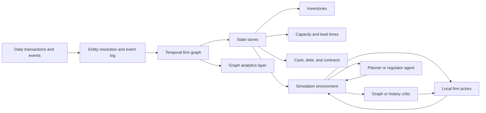
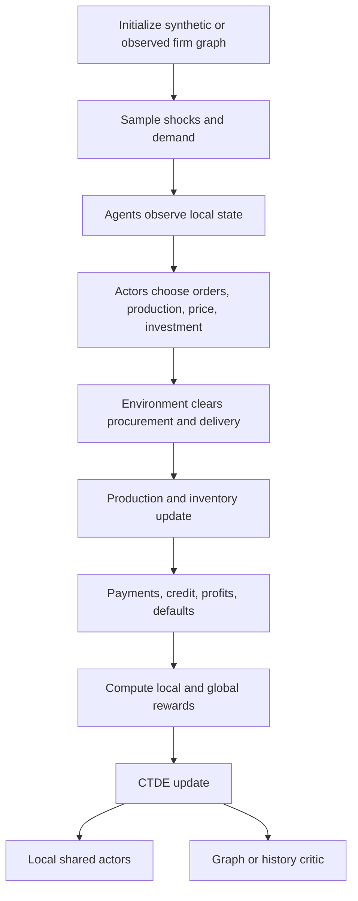

# Firm-Level Production Networks, Dynamic Input–Output Models, and Multi-Agent Reinforcement Learning for Firm Simulations

## Executive summary

The most relevant research base for your goal is **not** classical input–output analysis alone, but the intersection of **production-network economics**, **dynamic input–output models with inventories and bottlenecks**, **agent-based computational economics**, and **multi-agent reinforcement learning under centralized training / decentralized execution**. Classical Leontief models remain the cleanest baseline because they formalize upstream–downstream dependence; modern work extends them with heterogeneous firms, sparse networks, inventories, lead times, endogenous link formation, and out-of-equilibrium dynamics. citeturn33search1turn31search3turn33search2turn0search1turn0search2turn5search1turn6search2

For a simulator in which firms choose **orders, production, prices, supplier selection, and investment**, the best representation is usually a **dynamic temporal graph** rather than a static matrix. A Leontief matrix is still useful as a calibration object, local linearization, or benchmark policy model, but it is too rigid to capture substitution, buffering by inventory, delayed delivery, rewiring, and default cascades. Dynamic input–output models and recent supply-chain GNN papers both reach the same conclusion from different directions: inventories, essential inputs, and temporal structure are load-bearing. citeturn6search2turn6academia48turn15search1turn22academia49turn22academia50turn16academia48

For RL, the strongest default baseline is **parameter-shared local actors plus a centralized critic**, trained under **CTDE**. Among mainstream algorithms, **MAPPO** is the most pragmatic starting point; **MADDPG** is useful mainly when actions are strongly continuous and low-dimensional; **COMA** is attractive when shared reward and credit assignment dominate; **mean-field MARL** is the most relevant scaling idea for very large agent populations. A graph-based critic is a natural fit for production networks, but recent theory warns that “more centralized” critics are not always better under partial observability; critics should generally use **history-aware or belief-like representations**, not just an unrealistic omniscient global state. citeturn2academia24turn3search0turn1search0turn1academia49turn4academia38turn4search3turn1academia52

The hardest bottleneck is still **data**. Administrative VAT/e-invoice, customs, and payment-rail data are closest to a true firm-to-firm production graph, but they are normally restricted. Commercial products such as **Orbis**, **Dun & Bradstreet**, **FactSet Supply Chain**, and **Panjiva** are practically useful, especially for entity resolution and partial edge discovery, but recent evidence shows that missingness and reporting thresholds materially bias observed production-network properties. Public U.S. sources—**BEA input–output accounts**, **Census BDS/SynLBD**, **LBD/LFTTD via FSRDC**, **SAM.gov**, and **USAspending**—are best used for calibration, validation, and public procurement layers, not as a full production graph. citeturn11search0turn17search1turn16search0turn12search0turn10search2turn18search4turn18search0turn10search0turn13search0turn12search1turn13search2turn15search2

The most research-grounded build path is therefore: **start with a stylized dynamic production-network simulator**, calibrate it to sectoral I–O plus firm marginals, train **shared firm policies** on a moderate synthetic graph, introduce **inventories and lead times**, then add **investment and rewiring**, and only later move toward administrative or commercial microdata. That sequencing is much more consistent with where the literature is mature today than trying to jump directly to “millions of fully distinct RL firms trained end-to-end.” citeturn15search0turn7academia50turn21academia44turn21academia51turn22academia52

## Foundations in production networks and dynamic input–output

Leontief’s input–output method is still the canonical starting point because it formalizes production as an interdependent system of deliveries; that contribution is exactly what the Nobel committee recognized in 1973. The modern textbook reference remains Miller and Blair, which explicitly situates static, dynamic, and extended I–O models in the same framework. citeturn33search1turn31search3

The decisive shift over the last decade has been from **sectoral I–O tables** to **production networks**. Acemoglu, Carvalho, Ozdaglar, and Tahbaz-Salehi showed that micro shocks can produce aggregate fluctuations when the supplier network is sufficiently asymmetric, while later work by Carvalho and Voigtländer and by Acemoglu and Azar emphasized network evolution and endogenous link formation. Bigio and La’O, and Baqaee and Farhi, then generalized the analysis to distortions, heterogeneous producers, and richer aggregation. In short, the theory frontier has moved from “multipliers in a fixed table” to “shock propagation in heterogeneous sparse networks.” citeturn33search2turn0search1turn0search0turn0search2turn5search1turn5search0turn5search2

Empirically, firm-level work confirms that production networks are **sparse, heavy-tailed, and structurally unequal**. Atalay, Hortaçsu, Roberts, and Syverson documented the network structure of production; later work on Japan, Hungary, Ecuador, and the Netherlands pushed much closer to true firm-level network measurement. Recent review evidence in 2026 is especially important: when researchers compare administrative production networks with no reporting thresholds to commercial datasets, many “stylized facts” turn out to be sensitive to missing edges and coverage bias. That matters directly for any RL simulator calibrated on vendor data. citeturn5search5turn5academia49turn15search1turn6search0turn15search0turn15search2turn14search0

Dynamic input–output work has also become much more realistic. Pichler, Pangallo, del Rio-Chanona, Lafond, and Farmer showed that out-of-equilibrium dynamic I–O models with inventories and essential-input logic can forecast shock propagation far better than static multiplier thinking would suggest, especially in episodes like COVID. Engineering-style inventory extensions of dynamic I–O models had already pointed in this direction: inventories are not a detail but a stabilizer and propagation channel. This lesson carries over almost one-for-one to firm-agent simulation. citeturn6search2turn6academia48turn6search4

The practical takeaway is that a **firm simulator should treat the Leontief matrix as one layer of structure, not as the whole world**. Use it for calibration, counterfactual accounting, and sanity checks. But for decision-making agents, make the operative environment a **temporal network with inventories, delays, and feasibility constraints**. citeturn31search3turn6search2turn22academia49turn22academia52

## Multi-agent reinforcement learning for economic systems

The core RL design pattern you want is **centralized training with decentralized execution**. That family includes **MADDPG**, which uses centralized critics conditioning on other agents’ actions in continuous-action settings; **COMA**, which uses a counterfactual baseline for multi-agent credit assignment; **MAPPO**, which adapts PPO with centralized value estimation and has become a very strong empirical baseline; and **mean-field MARL**, which replaces explicit interactions with a population average and is therefore the most natural scaling idea for very large N. citeturn3search0turn1search0turn2academia24turn1academia49

For a production-network environment, these methods have different sweet spots. **MAPPO** is the best first choice when you want stability, shared policies across many similar firms, robust policy optimization, and relatively simple engineering. **MADDPG** is appropriate if firm actions are truly continuous and sensitive—such as finely tuned price, production-rate, or order-size controls—but it tends to be more brittle. **COMA** is strongest when all firms share a heavily coupled common reward and the main pain point is attribution of credit to one firm’s action. **Mean-field** becomes important when you move from thousands of heterogeneous important agents to a large tail of approximately exchangeable firms. citeturn2academia24turn3search0turn1academia49turn1search0

A key recent caution is that **centralized critics are not automatically a free lunch**. Lyu and coauthors show that state-based centralized critics can introduce harmful bias and variance in partially observable settings; in other words, a critic that sees an unrealistic “god’s-eye state” may train the wrong thing. For your use case, that means the critic should usually be a **graph/history critic**: it should aggregate firm histories, local neighborhoods, and public state, rather than merely ingesting a simulator-only omniscient snapshot. citeturn4academia38

Direct economic applications of MARL are still relatively sparse, but they are growing. **The AI Economist** is the best-known two-level economic RL system, where agents and a planner learn jointly. **Democratic AI** applies RL to mechanism design with human preference aggregation. **ABIDES-Economist** adds households, firms, government, and a central bank inside a simulator that supports learned agent behaviors. **R-MABM** studies what happens when bounded-rule firms in a macro ABM are gradually replaced by profit-maximizing RL firms. **EconoJax** focuses on simulation speed, showing that JAX implementations can make economic RL experiments much more iterative. citeturn7academia50turn7search3turn21academia44turn21academia46turn21academia51

That body of work suggests a recommendation that fits your problem well: **separate representation, control, and planning**. Let firm actors remain local and cheap; let the critic reason over a graph; and, if you care about global welfare, add either a planner agent or explicit constrained optimization rather than burying everything in one monolithic firm reward. That division mirrors the most successful economic RL papers to date. citeturn7academia50turn21academia44turn21academia51turn4academia38

## Graph models and digital-twin architectures

A firm economy is more naturally a **temporal directed multigraph** than a table. Nodes can represent firms, establishments, or business units; edges can represent transactions, contracts, logistics relationships, financing, or procurement links; node states can track inventories, capacity, cash, debt, and product mix; and edge attributes can carry volumes, prices, lead times, reliability, and substitutability. This framing is exactly what recent supply-chain GNN work exploits. citeturn22academia49turn22academia50turn16academia48turn15search1

Recent graph-learning papers go beyond forecasting transaction edges. Chang and coauthors explicitly try to **learn hidden production functions** from temporal transaction graphs using a temporal GNN plus an inventory module, and they release **SupplySim** as an open-source simulator for this setting. Ahn and coauthors use GNNs for probabilistic supply and inventory prediction in large real supply chains. Kotecha and del Rio-Chanona combine **GNN representations with MARL** for decentralized inventory control under CTDE. These are not yet “digital twins of a full national economy,” but they are very close to the modeling building blocks you need. citeturn22academia49turn22academia50turn22academia52

Graph-critic MARL is also well aligned with production networks because it respects locality and variable neighborhood size. Hierarchical graph attention critics, graph-convolution communication layers, and more general “GNN meets MARL” architectures are designed for settings where the interaction graph matters as much as the local state. That is much closer to a supply network than flat concatenation of all agents’ observations. citeturn4search3turn1academia52turn4academia40

The most defensible “digital twin” architecture for an economy today is therefore a **hybrid**: graph data infrastructure for state and lineage, dynamic simulation for transitions, and CTDE RL for firm decisions. This is a synthesis of patterns already present in dynamic I–O forecasting, economic ABM platforms, and graph-based supply-chain learning. citeturn6search2turn21academia44turn21academia51turn22academia49turn22academia52

A final engineering point is important: **graph databases are for storage, query, and lineage; sparse linear algebra and GNN systems are for computation**. Neo4j and TigerGraph are well suited to multi-hop dependency queries and operational graph services; GraphBLAS-style sparse algebra is better for centrality, propagation, and matrix-like graph operators; PyG and DGL are better for learned representations. Mixing these layers cleanly is a major design win. citeturn26search0turn26search2turn25search0turn27search2turn24academia56turn28academia48turn29academia50

## Data landscape and access

The data hierarchy is straightforward: **administrative transaction data** is best, **commercial relationship data** is second-best, and **public aggregate/statistical data** is mainly for calibration and validation. The 2026 review by Bacilieri and coauthors is the most useful summary here: network statistics look much more stable across administrative datasets with full coverage than across commercial datasets with missing edges. citeturn15search2

| Data source | What it gives you | Access notes and main caveats |
|---|---|---|
| Administrative VAT / e-invoice data from tax authorities, as used in Hungary, Ecuador, Peru, and Bulgaria citeturn14search3turn15search0turn14search5turn14academia52 | Closest thing to a true domestic firm-to-firm transaction graph; can support revenue, sector, and sometimes product-level reconstruction | Usually restricted, approval-based, and country-specific; thresholding and tax-reporting rules matter a great deal. citeturn14search3turn15search2 |
| Payment-rail / wire-transfer data, as in the Brazilian wire-transfer study citeturn14search4turn14academia51 | High-frequency bilateral payments, often broader and timelier than accounting data | Usually highly restricted; payments are not identical to physical inputs and may mix trade, finance, and services. citeturn14search4 |
| Customs / shipping data via **Panjiva** citeturn12search0 | Over 2 billion shipment records and 9 million companies; strong for cross-border flows and supplier discovery | Proprietary; mostly international and shipment-centered, not a full domestic production graph. citeturn12search0turn12search4 |
| U.S. procurement via **SAM.gov** and **USAspending** citeturn12search1turn13search2 | Public contract opportunities, awards, agencies, recipients, obligations | Useful for a government-demand layer and public-customer edges, not for the whole private production graph. citeturn12search1turn13search2 |
| **Dun & Bradstreet** Data Cloud / supplier-risk products citeturn17search1turn17search0 | 600M+ entities, D-U-N-S identifiers, corporate relationships, supplier-risk coverage | Proprietary; strong for entity resolution and supplier intelligence, weaker as a full revealed transaction network. citeturn17search1turn17search0 |
| **Orbis** by Moody’s / Bureau van Dijk citeturn11search0turn9search0 | 625M+ companies from 170+ sources, ownership trees, private-company financials | Proprietary or academic-license access; excellent for firm heterogeneity and ownership, limited direct trade-edge truth. citeturn11search0turn9search0 |
| **FactSet Supply Chain Relationships** citeturn16search0turn16search2 | Direct and reverse supplier/customer relationship graph, daily updates, disclosure lineage | Proprietary; more public-company and disclosure oriented than administrative trade truth. citeturn16search0turn15search2 |
| **Compustat** via S&P / WRDS citeturn19search2turn19search3 | Standardized fundamentals for 80,000+ active and inactive companies with long history | Excellent for balance sheets, investment, and public-firm calibration; poor direct coverage of private-firm edges. citeturn19search2 |
| U.S. **Census LBD**, **LFTTD**, **Business Register/SSEL** citeturn10search0turn13search0turn20search0turn20search4 | Employer-universe longitudinal microdata, linked customs transactions, frame data linking firms and establishments | Restricted to approved researchers in secure environments; strongest U.S. microdata foundation if you can obtain access. citeturn10search0turn13search0turn20search4 |
| Public calibration sources: **BEA Input–Output Accounts**, **BDS**, **SynLBD**, **UN Comtrade** citeturn10search2turn18search4turn18search0turn12search4 | Sectoral I–O, business dynamics aggregates, synthetic establishment microdata, international trade aggregates | Public and invaluable for priors and validation, but too aggregated or synthetic to substitute for true firm-to-firm transactions. citeturn10search2turn18search4turn18search0turn12search4 |

The most realistic research strategy, if administrative microdata is out of reach, is to **fuse** public sectoral I–O tables, firm-level financials, and partial relationship data, then generate **synthetic firm-level networks** subject to production constraints. Fessina and coauthors show that this kind of reconstruction can recover meaningful systemic-risk structure if the sector-level information is rich enough. citeturn15search0turn6search0

## Simulator design, baselines, and curricula

A good first simulator should be a **partially observable stochastic game on a temporal production graph**. Each firm should observe its local inventories, open orders, supplier reliability, customer backlog, capacity, debt, cash, prices, and a compressed public market state. Actions should include at least: accepting or rejecting orders, choosing production quantities, allocating scarce inputs across orders, ordering from suppliers, setting or adjusting prices, and making discrete investment choices in capacity or resilience. That state/action design is much closer to the recent supply-chain and economic RL literature than a pure “choose output” Leontief setup. citeturn21academia44turn22academia52turn6search2

If your goal is a realistic economic emulation, the environment step should include: procurement and delivery with lead times; production using essential and non-essential inputs; inventory updates; payment settlement and trade credit; capacity depreciation and expansion; bankruptcy or default logic; and possibly supplier rewiring. Dynamic I–O models and recent firm-level systemic-risk work both suggest that ignoring inventories, delays, and essential-input logic badly distorts propagation. citeturn6search2turn15search1turn16academia48

A concrete training curriculum that fits the literature is:

- **Phase one:** static network, single product per firm type, no rewiring, fixed prices, and hard-coded base-stock inventory rules. This isolates accounting and feasibility bugs before RL is introduced. Dynamic I–O work shows this stage is essential because inventories alone materially change outcomes. citeturn6search2turn6search4  
- **Phase two:** replace one decision block at a time with RL, typically order acceptance or inventory-policy parameters, while the rest of the firm remains rule-based. This mirrors the parameterized heuristic approach in recent GNN+MARL supply-chain control. citeturn22academia52  
- **Phase three:** move to **shared-policy MAPPO** across homogeneous firm classes, with a centralized critic and decentralized execution. MAPPO’s empirical record makes it the right first serious baseline. citeturn2academia24turn23search0  
- **Phase four:** swap the critic for a **graph/history critic** and compare against flat centralized critics. This is where you test whether the network structure is truly being used. citeturn4search3turn1academia52turn4academia38  
- **Phase five:** introduce **investment**, durability, and delayed payoffs. This is where MADDPG-style continuous control becomes more relevant, though MAPPO often remains the simpler and stronger baseline. citeturn3search0turn2academia24  
- **Phase six:** add a planner, regulator, or subsidy/tax layer if you care about welfare, resilience, or other macro objectives beyond firm profit. The AI Economist is the obvious precedent. citeturn7academia50  

Reward design should stay explicit and decomposable. A practical template is a weighted combination of **firm profitability**, **service level / fill rate**, **inventory efficiency**, **resilience penalties** for creating systemic fragility, and optionally a **global welfare transfer term**. What should not happen is that the actor optimizes one objective while the critic silently estimates another; if you want different viewpoints, use **auxiliary critics** or **constrained RL**, not mismatched objectives hidden inside one actor–critic pair. Standard CTDE methods assume critics estimate the return relevant to the actors’ training signal. citeturn1search0turn3search0turn2academia24turn4academia38

Evaluation should span both micro and macro metrics: profit, bankruptcies, service levels, lateness, inventory turns, bullwhip amplification, utilization, investment efficiency, aggregate output, price volatility, recovery time after shocks, welfare, and inequality across firm classes. For a production-network simulator, resilience metrics should be first-class citizens; recent systemic-risk papers show that firm importance is highly uneven and highly consequential. citeturn15search1turn15search0turn16academia48

At scale, the most important engineering trick is **parameter sharing plus embeddings**, not one fully separate policy per firm. Use firm-type embeddings, size buckets, sector embeddings, and learned neighborhood summaries so that one shared policy can specialize across many firms. For the long tail, use mean-field approximations or hierarchical aggregation; reserve explicit heterogeneous training for the strategically important core of the graph. citeturn1academia49turn2academia24turn21academia51

## Open challenges and research directions

The first open challenge is still **measurement**. Transactions are not identical to production coefficients; cash timing differs from physical use; inventories decouple purchase from production; services and intangibles are hard to map into input bundles; and multi-product firms violate the “one firm, one good” simplification. The literature increasingly responds by moving to product- and establishment-level models, but that makes both data and state spaces much harder. citeturn6search2turn16academia48turn22academia49

The second challenge is **data access and privacy**. The best datasets are mostly confidential. U.S. Census microdata are heavily restricted; tax and payment data are even more sensitive; and commercial datasets are biased in ways that matter for network topology and systemic risk. This is why synthetic-network reconstruction from sector tables and firm marginals is becoming a serious research area rather than a stopgap. citeturn20search4turn10search0turn13search0turn15search0turn15search2

The third challenge is **MARL nonstationarity and credit assignment**. As firms learn simultaneously, demand, prices, and supplier reliability become endogenous. COMA and related methods address part of the credit-assignment problem, but there is still very little evidence on stable training with large heterogeneous populations under delayed investment rewards. Recent theoretical work on centralized critics adds another warning: more information is not automatically better if it is the wrong information structure. citeturn1search0turn4academia38

The fourth challenge is **validation**. It is easy to build a simulator that “looks economic.” It is much harder to calibrate it so that degree distributions, concentration, propagation, inventory dynamics, pricing regularities, and recovery paths match observed stylized facts. ABIDES-Economist, AI Economist, and EconoJax are important partly because they foreground validation and experimental throughput rather than only algorithmic novelty. citeturn21academia44turn7academia50turn21academia51

The most promising research directions are clear. One is **hybrid differentiable simulation + RL**, where differentiable sparse solvers and graph modules support better planning gradients. Another is **graph-native critics with inventory-aware state models**, following the direction of recent supply-chain GNN work. A third is **product-level synthetic network generation** from public I–O plus partial microdata. A fourth is **offline or imitation pretraining** on historical traces, then online fine-tuning in simulation. And a fifth is **hierarchical firm/planner training**, where a regulator or platform agent internalizes welfare goals that firms alone will not. citeturn27academia51turn22academia49turn22academia52turn15search0turn7academia50

## Comparison table, reading order, and starter code

The table below is **selected rather than exhaustive**, with an emphasis on papers and projects most useful for your specific problem.

| Paper or project | Year | Methods | Scale / data | Main finding for your use case |
|---|---:|---|---|---|
| **Leontief, “Quantitative Input and Output Relations...”** citeturn32search2turn33search1 | 1936 | Linear I–O, fixed coefficients | U.S. interindustry tables | Best baseline accounting model for interdependence; too static for adaptive firm decisions |
| **Atalay, Hortaçsu, Roberts, Syverson, “Network Structure of Production”** citeturn5search5 | 2011 | Empirical production-network analysis | U.S. buyer–supplier links | Firm networks are sparse and structured, not dense tables |
| **Acemoglu et al., “The Network Origins of Aggregate Fluctuations”** citeturn33search2 | 2012 | Shock propagation in input–output networks | Sector network theory | Supplier asymmetry and higher-order linkages matter for macro effects |
| **Carvalho and Voigtländer, “Input Diffusion and the Evolution of Production Networks”** citeturn0search1 | 2014 | Network formation / input adoption | Sector and firm evidence | Networks evolve endogenously via local search and adoption |
| **Bigio and La’O, “Distortions in Production Networks”** citeturn0search2 | 2020 | Distorted production-network macro theory | Theoretical / calibrated | Network structure changes how distortions and markups transmit |
| **Baqaee and Farhi, HA-IO / micro foundations** citeturn5search1turn5search0turn5search2 | 2018–2023 | Heterogeneous-agent I–O aggregation | General equilibrium theory | Firm heterogeneity and nonlinear aggregation matter; sector averages can mislead |
| **Pichler et al., dynamic I–O model** citeturn6search2turn6academia48 | 2022 | Out-of-equilibrium dynamic I–O with inventories | UK sector data | Inventories and essential inputs are crucial for realistic shock dynamics |
| **Diem et al., firm-level systemic risk** citeturn15search1 | 2022 | Firm-level network contagion | Nationwide supply network | Firm systemic importance is measurable and highly unequal |
| **Ialongo et al., Dutch firm-level I–O reconstruction** citeturn6search0turn6academia53 | 2022 | Reconstruction under production constraints | Dutch transaction data | Product constraints improve inferred firm-level network realism |
| **Fessina et al., firm-level network inference from sector data** citeturn15search0 | 2026 | Maximum-entropy / gravity reconstruction | Ecuador benchmark network | Synthetic firm networks can be useful if sector and firm constraints are rich enough |
| **Bacilieri et al., “Firm-level production networks: What do we really know?”** citeturn15search2 | 2026 | Cross-dataset benchmarking | Administrative vs commercial datasets | Missing data strongly biases many firm-network properties |
| **MADDPG** citeturn3search0 | 2017 | Centralized critic, decentralized actors | Cooperative/competitive MARL | Useful when actions are continuous and low-dimensional |
| **COMA** citeturn1search0 | 2018 | Counterfactual actor–critic | Cooperative MARL | Good for shared-reward settings with hard credit assignment |
| **Mean Field MARL** citeturn1academia49 | 2018 | Population approximation | Large-N MARL | Natural scaling idea for large populations of similar firms |
| **MAPPO** citeturn2academia24turn23search0 | 2021–2022 | PPO under CTDE | Major MARL benchmarks | Best pragmatic first baseline for a large economic simulator |
| **AI Economist** citeturn7academia50 | 2020–2022 | Two-level RL with planner | Stylized economy | Strong template for adding welfare or planner objectives |
| **ABIDES-Economist** citeturn21academia44 | 2024 | ABM economy with learning agents | Households, firms, central bank, government | Good blueprint for heterogeneous macroeconomic simulation |
| **R-MABM** citeturn21academia46 | 2024 | RL firms inside macro ABM | Research macro ABM | Shows how profit-maximizing RL firms change macro dynamics |
| **Chang et al., learning production functions with GNNs** citeturn22academia49 | 2024 | Temporal GNN + inventory module + SupplySim | Real supply-chain data + simulator | Closest ML paper to “learn hidden firm production behavior on a graph” |
| **Kotecha and del Rio-Chanona, GNN + MARL inventory control** citeturn22academia52 | 2024 | CTDE MARL with GNN state encoding | Supply-chain benchmarks | Strong direct precedent for graph-based multi-agent firm control |
| **EconoJax** citeturn21academia51 | 2024 | Fast JAX economic simulator | 100-agent experiments | Useful for rapid iteration and large experiment throughput |

A sensible reading order is:

1. Start with **Leontief** and **Miller–Blair** to get the accounting backbone clear. citeturn33search1turn31search3  
2. Then read **Acemoglu et al.**, **Carvalho and Voigtländer**, **Bigio and La’O**, and **Baqaee/Farhi** to understand modern production-network theory. citeturn33search2turn0search1turn0search2turn5search1turn5search0  
3. Then read **Pichler et al.**, **Diem et al.**, **Ialongo et al.**, **Fessina et al.**, and **Bacilieri et al.** to understand dynamic propagation, reconstruction, and data limitations. citeturn6search2turn15search1turn6search0turn15search0turn15search2  
4. Then move to **MADDPG**, **COMA**, **Mean Field**, **MAPPO**, and the 2024 paper on centralized critics. citeturn3search0turn1search0turn1academia49turn2academia24turn4academia38  
5. Finish with **AI Economist**, **ABIDES-Economist**, **R-MABM**, **Kotecha and del Rio-Chanona**, **Chang et al.**, and **EconoJax** for implementation patterns. citeturn7academia50turn21academia44turn21academia46turn22academia52turn22academia49turn21academia51  

For starter code and software, the most useful stack today is:

- **MAPPO official implementation** for the first serious MARL baseline. citeturn23search0  
- **PettingZoo** if you want a clean multi-agent environment API and broad ecosystem compatibility. citeturn26academia50  
- **Ray RLlib** if you want scalable multi-agent training infrastructure and policy mapping at cluster scale. citeturn24search0turn24search3  
- **TorchRL’s multi-agent PPO tutorial** if you want a readable PyTorch reference for parameter sharing and centralized critics. citeturn29search1  
- **PyTorch Geometric** or **DGL** for graph critics and temporal graph models; **DistDGL** is particularly relevant once graphs become very large. citeturn28academia48turn29search0turn29academia50turn25academia63  
- **GraphBLAS-style sparse algebra** if you need fast graph analytics or sparse propagation kernels outside neural training. citeturn27search2turn24academia56  
- **Neo4j** or **TigerGraph** if you need a production graph store for lineage, dependency lookup, and multi-hop operational queries. citeturn26search0turn25search0  
- **EconoJax** if you want JAX-native experiment velocity; but note that **JAX’s experimental sparse module is not recommended for performance-critical use**, and **Jraph was archived in May 2025**, so JAX graph tooling needs more care than the PyTorch ecosystem. citeturn21academia51turn27search1turn28search0  

The highest-confidence recommendation, combining all of the above, is this: **build a temporal graph simulator with inventories and lead times; start with MAPPO and parameter sharing; use a graph/history critic under CTDE; calibrate to public I–O plus firm marginals or confidential admin data if available; and treat static Leontief structure as a benchmark layer, not the final environment.** citeturn6search2turn2academia24turn4academia38turn15search0turn10search2