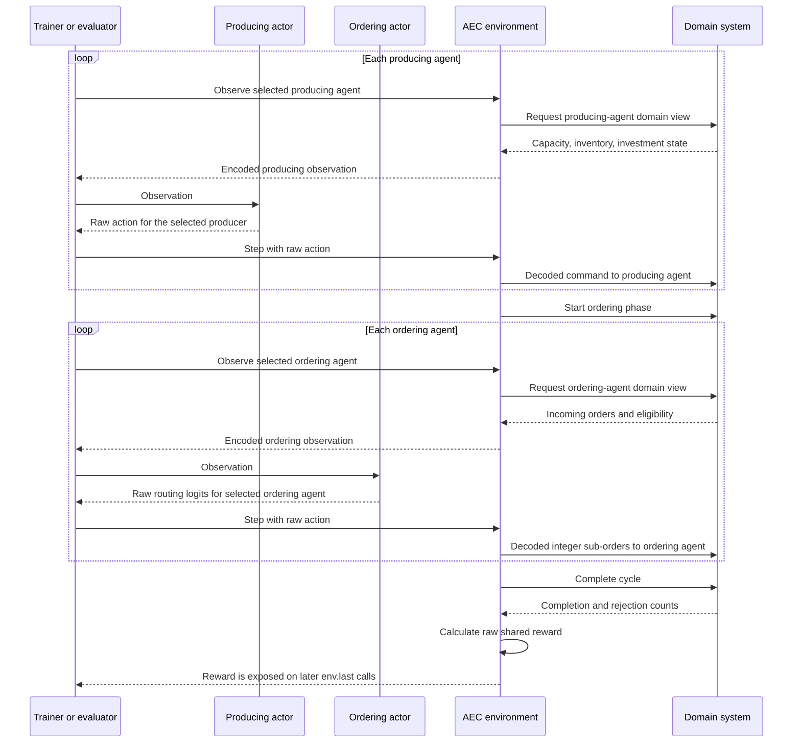
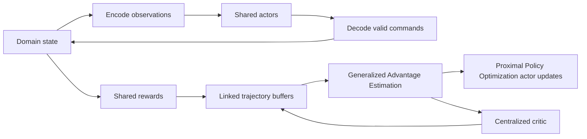
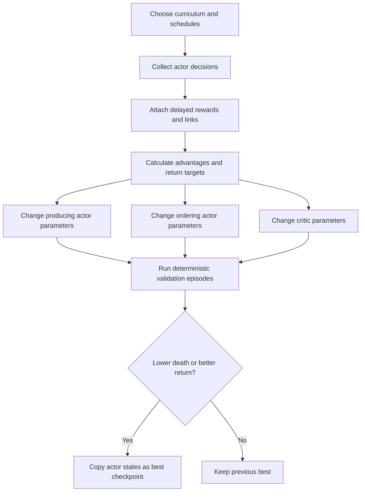

# Machine Learning and Reinforcement Learning Architecture Guide

This document explains the machine learning (ML) and reinforcement learning
(RL) implementation in the tokenomics project. It is written for readers who
understand ordinary software systems but may be new to neural networks or RL.

The guide first separates the software layers and declares one worked
experiment used by later examples. Section 3 is a glossary preview so terms
such as step, episode, rollout, and iteration are defined before they recur.
The main technical narrative then follows data in execution order:

1. What economy and experiment are being run?
2. What decisions exist in that economy?
3. How are those decisions represented as fixed-size numbers?
4. How are model outputs converted back into valid domain commands?
5. What neural networks produce those outputs?
6. How does simulated experience become training data?
7. How are the networks updated and verified?

The implementation is intentionally small and readable. It is a research
testbed and reference implementation, not yet a large-scale production training
platform.

## 1. The Short Version

The project simulates a cooperative production economy:

1. Consumers create demand for products.
2. Producers decide whether to replenish input inventory and invest in
   restoration, upgrades, or inventory expansion.
3. Ordering agents decide how to route each order among eligible producers.
4. Producers execute accepted work using capacity and inventory.
5. The system reports fulfilled demand, rejected demand, remaining capacity,
   and other outcomes.

RL controls two kinds of decisions:

- one shared **producing policy** controls every producing agent;
- one shared **ordering policy** controls every ordering agent.

The policies are represented by neural networks called **actors**. Training also
uses one **critic** neural network, which estimates the future reward expected
from the current situation.

The models do not read Python domain objects directly. The environment first
encodes domain state into fixed-size observation vectors. Actors output
fixed-size action vectors. Decoders turn those vectors into valid integer
commands for the economic simulator.

## 2. Three Separate Software Layers

Understanding the layer boundaries prevents many common mistakes.

### 2.1 Domain simulator

The domain layer implements the economic rules:

- products and recipes;
- production capacities;
- degradation;
- inventory and replenishment;
- restoration, upgrades, and inventory expansion;
- order funding, auctions, reservations, completion, and rejection;
- system death.

This layer does not contain neural networks or PyTorch code. Its main entry
point is `tokenomics/domain/system.py`.

The producing and ordering **agents belong to this domain layer**. They are
domain entities with identifiers, state, rules, and command handlers. For
example, a producing agent owns capacity and inventory and knows how to execute
a replenishment command.

A domain agent does not import, contain, or call an actor neural network. It
does not know how its command was selected.

### 2.2 Reinforcement-learning environment

The environment layer translates domain objects into the fixed-size numeric
interface expected by RL:

- domain state becomes observation vectors;
- raw numeric actions become valid domain commands;
- domain outcomes become rewards and episode metrics;
- agents take turns through PettingZoo's Agent Environment Cycle (AEC)
  interface.

Important files:

- `tokenomics/env/aec_env.py`
- `tokenomics/env/spaces.py`
- `tokenomics/env/encode.py`
- `tokenomics/env/decode.py`

### 2.3 Trainer and evaluator

The training layer:

- creates actors and a critic;
- samples actions;
- collects experience;
- estimates which actions were better or worse than expected;
- updates model parameters;
- evaluates deterministic policies;
- selects and saves a checkpoint.

A **checkpoint** is a saved snapshot of learned actor parameters plus the
metadata needed to reconstruct and validate those actors later.

Important files:

- `tokenomics/train/smoke_ppo.py`
- `tokenomics/eval/baselines.py`
- `tokenomics/eval/runner.py`
- `tokenomics/eval/signal_check.py`

The **actors and critic belong to this training/model layer**. An actor is a
neural network that makes a decision on behalf of the domain agent whose turn
the environment is processing.

The complete direction is:

```text
domain agent state
    -> environment asks the domain agent for a view
    -> environment encodes the view as numbers
    -> trainer/evaluator receives the observation
    -> trainer/evaluator asks the actor for an action
    -> environment decodes the action as a domain command
    -> domain agent executes the command
```

The environment is the adapter between domain entities and neural networks.

## 3. Core Terms and Time Scales

This section is a reference glossary, not a claim that training happens before
encoding. The detailed narrative begins with observation/action spaces in
Section 4, decoding in Section 5, and only then moves into reward collection and
learning.

### Reference economy and worked experiment

Examples need a declared context. Otherwise a phrase such as "nine agents per
cycle" looks like a universal rule when it is only true for one configuration.

Most concrete size examples in this guide use the **reference economy** loaded
from:

```text
tokenomics/config/phase1.json
```

The filename is historical. In this guide, "reference economy" means this exact
configuration:

| Property | Reference-economy value |
|---|---|
| Producers | `p1`, `p2`, `p3`, `p4` |
| Consumer | `c1` |
| Products | `10`, `11`, `20`, `30` |
| Composite chain | Product `20` needs input `10`; product `30` needs inputs `20` and `11` |
| Consumer demand | One unit of product `30` per economic cycle |
| Producing turns per cycle | 4, one for each producer |
| Ordering turns per cycle | 5, one for `c1` and one for each producer |
| Total live agent steps per cycle | `4 + 5 = 9` |

Producers need ordering turns because their restoration, upgrade,
inventory-expansion, and replenishment requests also create economic orders.
The consumer's ordering turn routes final consumer demand.

When a small numeric rollout example is needed, assume:

| Experiment setting | Teaching value | Meaning |
|---|---:|---|
| Training seed | `7` | Initializes model randomness and the sequence of episode seeds |
| Environment instances | `2` | Run two independent simulator copies while collecting |
| Step budget | `36` | Collect 36 live agent decisions before learning |
| Horizon | `100` | Stop a still-live episode after 100 economic cycles |
| Training iterations | `3` | Repeat collect, learn, and evaluate three times |
| Curriculum | Off | Both instances use the unchanged reference economy |

These teaching values are smaller than a normal run so the arithmetic is easy
to inspect. They are not recommended hyperparameters.

The reference economy has fixed demand, so changing an episode seed does not
change its product or quantity. Configurations such as `complex.json` enable
seeded product and quantity variation. The same environment-seed mechanism is
used in both cases; a seed only changes features that the selected economy
declares random.

### Configuration, generated data, and model state

Supervised learning often starts from a fixed file of training examples. This
RL trainer does not. It **generates training data by running the simulator with
the current actors**.

An experiment is therefore defined by several different inputs:

| Input | What it controls |
|---|---|
| Economy configuration | Products, recipes, producers, capacity, costs, degradation, and demand distribution |
| Training seed | Initial neural-network weights, Gaussian action samples, and the sequence of environment reset seeds |
| Environment reset seed | The reproducible demand schedule for one episode when demand is randomized |
| Number of environment instances | How many independent simulator states contribute experience |
| Step budget | Number of live decisions collected before one learning update |
| Horizon | Maximum economic cycles in one episode |
| Iteration count | Number of collect-learn-evaluate repetitions |
| Curriculum settings | Which easier or full economy is used for training at each iteration |
| Validation seeds | Episodes used to compare and select checkpoints |
| Held-out seeds | Episodes reserved for the final report |

At the start of `train(seed=7)`, the trainer performs the equivalent of:

```text
initialize PyTorch random state with 7
initialize NumPy random-number generator with 7
build actor and critic weights using that PyTorch state
draw future environment reset seeds from that NumPy generator
```

One training seed therefore controls more than network initialization. It also
controls exploration samples and which seeded episodes become training data.
Independent training seeds test whether the learning result is robust to all
of those sources of randomness.

### Class, interface, and instance

The word **environment** is used at two related levels:

| Term | Meaning |
|---|---|
| Environment interface | The rules for `reset`, observation, action, reward, and turn order |
| Environment class | The Python implementation `TokenomicsAECEnv` |
| Environment instance | One concrete Python object created from that class, with its own mutable episode state |

For example:

```python
env_a = TokenomicsAECEnv(config=cfg, horizon=100)
env_b = TokenomicsAECEnv(config=cfg, horizon=100)
```

Both objects obey the same interface and initially use the same configuration.
They are still independent instances. Each has its own domain system, orders,
inventories, capacities, cycle counter, demand schedule, and episode statistics.

During collection, actions mutate each instance independently. If randomized
demand is configured, resetting the instances with different seeds normally
gives them different demand schedules. If demand is fixed, stochastic actor
actions can still make their economic states diverge.

### Agent and actor

An **agent** is a domain-level entity in the simulated economy. Examples are
producer `p3` and the ordering agent for consumer `c1`. It stores economic state
and executes domain commands.

An **actor** is a neural network in the training/model layer. It receives an
encoded observation and computes an action for the currently selected agent.

They are not the same thing:

```text
agent = domain entity that owns state and executes commands
actor = neural network that selects commands for agents
```

The agent does not use or call the actor. The trainer or evaluation controller
calls the actor, then passes the result through the environment to the agent.

Several agents can be controlled by one shared actor. In this project the
producing actor makes decisions for every producing agent. It can still produce
different decisions because each domain agent has different state and therefore
a different encoded observation.

Example:

```text
p3 domain state -> observation A -> shared producing actor -> action A -> p3 command
p4 domain state -> observation B -> shared producing actor -> action B -> p4 command
```

The neural-network weights are shared. The inputs and resulting decisions are
not.

### Layer ownership summary

| Item | Layer | Responsibility |
|---|---|---|
| Producing agent | Domain | Owns capacities/inventory and executes producing commands |
| Ordering agent | Domain | Owns incoming orders and executes routing commands |
| Observation encoder | Environment | Converts a domain view into a fixed numeric vector |
| Action decoder | Environment | Converts a raw model vector into a valid domain command |
| Producing actor | Training/model | Computes actions for producing agents |
| Ordering actor | Training/model | Computes actions for ordering agents |
| Critic | Training/model | Predicts future reward to help train the actors |
| Trainer | Training/model | Collects experience and changes neural-network parameters |

### Environment

The environment interface surrounds the economic simulator. A concrete
environment instance:

1. selects the next domain agent;
2. reads that agent's domain view;
3. encodes the view as numbers;
4. accepts a numeric action;
5. decodes and executes a domain command;
6. advances the economic cycle when all turns are complete;
7. calculates the RL reward and episode metrics.

### Observation

An observation is the fixed-size numeric vector given to an actor before it
acts. It is not necessarily the complete simulator state.

### Action

An action is the fixed-size numeric vector emitted by an actor. A decoder turns
it into a valid domain command.

### Policy

A policy is the rule that maps an observation to an action. The actor neural
network represents the learned part of the policy.

For this project, the complete executable decision pipeline is:

```text
actor raw action + environment decoder = valid domain decision
```

The actor learns preferences. The decoder supplies fixed rules such as integer
rounding, eligibility, headroom limits, and quantity conservation.

### Reward

A **reward** is a number produced by the environment to score a simulated
outcome. Positive terms represent desired outcomes; negative terms represent
costs or failures.

The domain simulator does not calculate an RL reward. It finishes an economic
cycle and returns factual counts such as:

```text
consumer units completed
consumer units rejected
producer orders completed or rejected
orders still in progress
inventory units held
```

The environment function `cycle_reward(...)` converts those counts into one
number:

```text
reward =
    +10 * completed consumer units
   -0.1 * inventory units held / number of producers
```

Suppose one completed cycle has:

```text
2 completed consumer units
1 rejected consumer unit
1 completed replenishment order
1 order still in progress
0 rejected producer orders
4 inventory units held
4 producers
```

Then:

```text
reward = 10*2 - 0.1*4/4
       = 19.9
```

This is a cooperative task, so the environment assigns the same cycle reward
to every active agent. The reward says how the economy performed; it does not
identify which individual decision caused the result.

The reward is delayed because it cannot be calculated after the first turn of
the cycle. A producer may act first, but the environment still needs all other
producing decisions, every ordering decision, production results, rejections,
and final inventory before the cycle score is known. The reward becomes
available only after the last ordering turn completes the cycle.

The reward does not directly modify a neural-network weight. Its training path
is:

```text
domain cycle result
    -> environment reward
    -> collector attaches reward to an earlier transition
    -> reward is scaled for numerical optimization
    -> Generalized Advantage Estimation (GAE) estimates advantage and critic return target
    -> actor and critic losses are calculated
    -> backpropagation calculates gradients, the parameter-change directions
    -> Adam changes neural-network parameters
```

The exact formula and optional training-only reward modifications are described
in Section 12.

### Agent step or decision step

One **agent step** is one decision processed for one selected domain agent:

1. the environment selects whose turn it is;
2. the environment reads that domain agent's view;
3. the encoder builds an observation vector;
4. the appropriate actor computes an action for the agent;
5. the environment decodes the action;
6. the domain agent executes the decoded command.

The term is called an "agent step" because it advances one agent's turn. It does
not mean the domain agent itself calls the neural network.

The trainer's command-line argument `--steps 1024` means:

```text
collect 1024 live agent decisions in total across all rollout environment instances
```

It does not mean 1024 complete economic cycles or 1024 episodes.

### Economic cycle

One **economic cycle** contains a full pass over every currently active agent:

1. every producing agent acts;
2. every ordering agent acts;
3. the domain completes production and order processing;
4. the environment calculates the shared cycle reward.

In the declared reference economy, a normal cycle contains:

```text
4 producing steps + 5 ordering steps = 9 live agent steps
```

Another configuration can have a different number of producers, consumers, and
therefore agent steps per cycle.

### Episode and horizon

An **episode** is one simulation run from `reset()` until an ending condition.
Reset constructs fresh domain state for that environment instance.

The **horizon** is the maximum number of complete economic cycles allowed in
one episode. With `horizon=100`, a live economy can run for at most 100 cycles
before the experiment stops that episode.

### Termination

**Termination** means the domain reached a genuine final state. In this project,
the required production system has died. No useful continuation exists from
that episode state, so its future bootstrap value is zero.

### Truncation or truncated simulation

**Truncation** means the environment intentionally stopped an otherwise live
episode because it reached the configured horizon.

Example:

```text
horizon = 100 cycles
the economy is still viable after cycle 100
the episode stops for a fixed-length comparison
result = truncated, not terminated
```

Truncation does not mean that the simulation crashed or returned invalid data.
The economy could theoretically continue, so training uses the critic to
estimate value beyond that artificial boundary.

### Transition

A **transition** is one completed training record associated with one agent
decision:

```text
observation
sampled action
reward caused during the following part of that agent's trajectory
critic information
termination or truncation information
link to the same agent's next transition
```

The transition cannot be completed when its action is sampled because the
cycle reward does not exist yet. The collector first stores an unfinished or
**pending transition**. When that same `(environment instance, agent)` is
selected again, `env.last()` exposes the reward accumulated since its previous
turn. The collector then attaches that reward to the pending record.

Example for producer `p4`:

```text
cycle 8, p4 turn:
    store observation and sampled action as pending

end of cycle 8:
    environment calculates shared reward 19.9

cycle 9, p4 turn:
    env.last() supplies the reward earned since p4 last acted
    collector completes p4's cycle-8 transition
```

At episode end, PettingZoo dead-agent steps expose the final reward and ending
flags so pending records can also be completed.

### Trajectory

A **trajectory** is an ordered chain of transitions from one continuing
interaction. In this multi-agent collector, the relevant chain for GAE is:

```text
same environment instance
+ same domain agent
+ same episode
+ successive turns of that agent
```

Rows next to each other in a shared role buffer do not necessarily belong to
the same trajectory. Explicit successor links preserve the real order.

### Collector

The **collector** is the `collect()` orchestration function in the trainer. It
is not a neural network and not part of the domain model.

Its job is to:

1. hold a list of environment instances;
2. ask each instance for its currently selected agent;
3. call the appropriate actor;
4. step the environment with the decoded action;
5. attach delayed rewards to pending transitions;
6. link each transition to the same agent's real successor;
7. reset an instance when its episode has ended;
8. stop when the live-decision budget is reached;
9. return temporary training buffers and rollout statistics.

### Buffer

A **buffer** is an in-memory table of transition fields collected for the
current training iteration. It is ordinary temporary data, not a neural
network.

A **batch** is the collection of buffer rows passed together to one model
update. The current trainer uses the full producing buffer as one producing
actor batch, the full ordering buffer as one ordering actor batch, and the
pooled rows as the critic batch.

The trainer uses two buffers:

| Buffer | Contains | Trains |
|---|---|---|
| Producing buffer | Decisions made for producing agents | Producing actor and shared critic |
| Ordering buffer | Decisions made for ordering agents | Ordering actor and shared critic |

They are separate because the two actors have different observation and action
shapes. Their critic rows can later be pooled because both roles use the same
centralized critic.

These are **on-policy buffers**: they contain experience generated by the
current actors, are used immediately for one **Proximal Policy Optimization
(PPO)** update, and are then discarded. They are not a long-lived replay
database.

### Rollout

A **rollout** is one bounded period of experience collection. The collector
runs the current actors in one or more mutable environment instances without
changing actor or critic parameters. The resulting transitions form the
training data for the current iteration.

For each selected domain agent, it records approximately:

```text
what the actor saw
what action the actor sampled
what reward later arrived
whether the episode ended
what the critic predicted
```

In the worked experiment, both environment instances use the same reference
economy and the same shared actor networks:

```text
shared producing actor --------> environment instance 0
                            \---> environment instance 1

shared ordering actor ---------> environment instance 0
                            \---> environment instance 1
```

The actors are shared; simulator state is not. The collector processes one
currently selected live agent from each instance in round-robin order:

```text
round 1: one turn in environment 0, then one turn in environment 1
round 2: next turn in environment 0, then next turn in environment 1
...
```

With two instances, nine live decisions per cycle, and `steps=36`, the budget
corresponds to approximately:

```text
36 decisions / (2 instances * 9 agents) = 2 cycles per instance
```

This is only an average. A rollout is not required to align with a cycle or an
episode boundary.

An environment instance mutates throughout the rollout:

```text
action
  -> domain orders/inventory/capacity change
  -> next observation reflects that changed state
  -> later cycle completes
  -> reward and episode statistics change
```

If one instance reaches death or horizon before the step budget is exhausted,
the collector finishes its pending final rewards, records the episode result,
calls `reset()` on that same Python object with a new episode seed, and continues
collecting:

```text
environment 0, episode A ends
environment 0 is reset
environment 0, episode B begins
rollout continues until the shared decision budget is full
```

The end and reset are collector lifecycle events. They are not actor actions.
The first live agent turn of episode B creates the next normal transition, and
trajectory links never cross from episode A into episode B.

Therefore one rollout can contain:

- transitions from many domain agents;
- transitions from several environment instances;
- the end of one episode and the beginning of another;
- only a middle section of an episode that continues next iteration.

The last case is common. Reaching the rollout step budget does not reset a live
environment. Its state is retained and continues in the next training iteration
unless a curriculum configuration change requires new instances.

### Rollout cut

A **rollout cut** occurs when the collector reaches its step budget in the
middle of a live episode. It is not termination and not episode truncation.

Because reward is delayed, the newest action for some live agents may still be
pending at the cut. The trainer removes those unfinished rows rather than
pretending they earned zero reward. Completed predecessor rows retain a critic
bootstrap value for the **frontier**, meaning the first state just beyond the
completed collected segment.

### Training iteration

One **training iteration** is one complete collect-learn-check round. It has
three understandable phases.

#### Phase A: collect examples

Run the current actors in the environment instances and collect one rollout.
No network parameters change during collection.

Example transition:

```text
actor observation: p4 has low input-20 inventory and open demand for product 30
sampled action: request 4 units of input 20 and request restoration
later raw cycle reward: +18
optimization reward after the 0.05 training scale: +0.9
critic prediction at decision time: +0.4
```

#### Phase B: build training targets

A **training target** is the value the learning code wants a model output to
move toward.

The actors and critic learn from different information:

| Model | Learning information | Plain meaning |
|---|---|---|
| Actor | Stored sampled action plus its advantage | Should this particular sampled action become more or less likely? |
| Critic | Numeric estimated discounted return | What future reward should this state have predicted? |

The critic has a direct numeric target. The actor does not receive a label such
as "the correct action is `[2, 0, 4, 1, 0, 0]`." RL normally does not know the
correct action. It only knows whether the sampled action worked better or worse
than expected.

Simplified example:

```text
critic predicted value = 0.4
estimated advantage    = +0.3
critic return target   = 0.4 + 0.3 = 0.7
```

Interpretation:

- the action did better than expected, so the actor
  should make similar actions more likely in similar observations;
- the critic predicted `0.4`, but its target is `0.7`, so its future prediction
  should move upward.

If the advantage were `-0.3`, the actor would reduce the sampled action's
probability and the critic target would be below its old prediction.

The real implementation calculates these values across linked trajectories with
reward discounting and **Generalized Advantage Estimation (GAE)**, explained
later.

#### Phase C: learn and evaluate

**Updating an actor** means:

1. run the stored observations through the actor again;
2. calculate how probable the stored sampled actions are now;
3. compare that probability with the probability during rollout;
4. use positive and negative advantages to calculate a loss;
5. use backpropagation and Adam to slightly change actor weights and
   `log_std` exploration parameters.

After the update, a similar observation may produce a different mean action.
For example, the replenishment mean might move from `2.0` to `2.1`.

**Updating the critic** means:

1. run stored critic inputs through the critic;
2. compare predictions with return targets;
3. calculate squared prediction error;
4. use backpropagation and Adam to change critic weights so predictions move
   toward those targets.

**Evaluating the policy** means running separate episodes after the update:

- use the full real configuration, even if training currently uses an easier
  curriculum level;
- use fixed validation environment seeds;
- use actor means instead of random Gaussian samples;
- do not change network weights;
- measure death rate, fulfilled orders/units, return, cycles, and minimum
  capacity.

The trainer ranks evaluated checkpoints by lowest death rate and then highest
return.

For example, `--iters 100 --steps 1024` requests 100 of these
collect-learn-check rounds, each using approximately 1024 new live decisions.

### Optimizer epoch

An **optimizer epoch** is one repeated pass over the same collected rollout
while updating a network. It is smaller than a training iteration.

The current trainer uses up to:

- four optimizer epochs for each actor;
- eight optimizer epochs for the critic.

These are repeated updates on one rollout, not new simulator experience.

### Return

The **return** is the accumulated future reward following a transition. It is
usually discounted so distant rewards count slightly less than immediate ones.

For three rewards and discount `gamma = 0.99`, a simplified return is:

```text
return = reward_0 + 0.99*reward_1 + 0.99^2*reward_2
```

### Value and advantage

The critic predicts a **value**, meaning expected future return.

An **advantage** estimates whether an action's outcome was better or worse than
that expectation:

```text
advantage = observed outcome - expected outcome
```

A positive advantage should make an action more likely. A negative advantage
should make it less likely.

### Parameters, loss, backpropagation, and optimizer

Neural-network **parameters** are the adjustable numbers inside the model,
mainly weights and biases. Training changes these numbers.

A **loss** is a temporary training score that says how the current model should
change. It is not the economic reward:

```text
reward = how well the simulated economy behaved
loss   = a mathematical quantity used to update a neural network
```

**Backpropagation** calculates how each parameter contributed to the loss. The
result is a gradient: a direction and strength for changing each parameter.

An **optimizer** applies those changes. This project uses Adam, an optimizer that
combines current gradients with moving averages of earlier gradients.

Very simplified example:

```text
current actor weight = 0.500
gradient says a small increase should improve the actor loss
Adam applies an update
new actor weight = 0.503
```

Thousands of such small parameter changes alter the actor's future decisions.

## 4. Spaces: The Contract Between Simulator and Model

Before choosing a neural network, the project must define:

- exactly which numbers a model receives;
- exactly which numbers it returns;
- the fixed order and meaning of those numbers;
- the allowed numeric range.

Gymnasium calls these contracts **observation spaces** and **action spaces**.
Both current action spaces use Gymnasium's `Box` type: a fixed-shape numeric
array with a lower and upper bound for every position.

### 4.1 Why fixed-size vectors and matrices?

A normal fully connected neural network expects every input to have the same
length. The economic simulator does not naturally have that shape:

- producers own different capacity types;
- some products need inputs while others do not;
- the number of live orders changes;
- different orders have different eligible producers.

The environment therefore creates stable global vocabularies and fixed slots:

- all capacity types are sorted into one capacity vocabulary;
- all recipe input products are sorted into one input-product vocabulary;
- all orderable products are sorted into one product vocabulary;
- variable orders are placed into `K` fixed order slots;
- absent or irrelevant values are represented by zero and masked when needed.

For the reference economy, a producing observation is conceptually a row vector:

```text
shape = (35,)

[capacity block | max-capacity block | flags | inventory block |
 producer summary | demand block | cycle progress]
```

An ordering action is conceptually a matrix:

```text
shape = (K, number of producers) = (9, 4)
```

The implementation flattens that matrix to a vector of length `36` for the
neural network and reshapes it during decoding.

### 4.2 Symbols used in dimension formulas

| Symbol | Meaning | Reference-economy value |
|---|---|---:|
| `Np` | Number of producers | 4 |
| `Nt` | Number of capacity types | 4 |
| `Ng` | Number of global input-product types used by composite recipes | 3 |
| `Nq` | Number of orderable products | 4 |
| `K` | Maximum visible order slots for one ordering agent | 9 |
| `Na` | Number of AEC agents | 9 |

For the reference economy, the sorted global input-product vocabulary is:

```text
[product 10, product 11, product 20]
```

Every producing action reserves one position for each of these products, even
when a particular producer uses only one or two of them.

### 4.3 Normalization and clipping

Raw domain numbers have different scales. A running flag is `0` or `1`, while
capacity may be `120` and tokens may be `1000`. Feeding these directly into one
network makes optimization harder because some inputs are numerically much
larger than others.

The environment divides raw values by configuration-derived references:

| Reference | Definition | Reference-economy value |
|---|---|---:|
| `cap_ref` | Largest initial total capacity owned by one producer | `120` |
| `token_ref` | Token emission per economic cycle | `1000` |
| `price_ref` | `max(1, token_ref / cap_ref)` | about `8.33` |
| `inv_ref` | Largest configured inventory limit, minimum `1` | `30` |

Worked examples:

| Raw domain value | Encoding | Encoded value |
|---|---|---:|
| Current capacity `60` | `60 / cap_ref` | `60 / 120 = 0.5` |
| Maximum capacity `120` | `120 / cap_ref` | `1.0` |
| Inventory `9` units | `9 / inv_ref` | `9 / 30 = 0.3` |
| Consumer tokens `250` | `250 / token_ref` | `0.25` |
| Cut-off price `4` | `4 / price_ref` | about `0.48` |
| Restoration running | Boolean flag | `1.0` |
| Restoration not running | Boolean flag | `0.0` |
| Cycle `25` of horizon `100` | `25 / 100` | `0.25` |

After encoding, every observation component is clipped to `[0, 10]`:

```text
encoded = min(10, max(0, normalized value))
```

Example: if an accumulated value normalizes to `12.4`, the network receives
`10.0`. Clipping prevents extreme values from dominating, but it also means
values above the limit become indistinguishable. Saturation should therefore be
monitored if configurations grow substantially.

Other normalization options were considered:

| Option | Why it is not the current default |
|---|---|
| Raw values | Different scales make optimization unnecessarily difficult |
| Batch normalization | Batch statistics mix agents and rollout states and differ between training and deployment |
| Running observation normalization | More adaptive, but adds mutable state that must be checkpointed and kept consistent |
| Per-feature min-max bounds | Requires reliable bounds for every changing economic feature |
| Current fixed references | Simple, deterministic, reproducible, and sufficient for the present bounded configs |

### 4.4 Producing observation layout

The producing observation dimension is:

```text
2*Nt + 1 + 3 + Ng + 3 + 2*Np + 2*Nq + 1
```

This is easier to understand as named blocks:

| Block | Width | Reference-economy width | Meaning |
|---|---:|---:|---|
| Current capacity | `Nt` | 4 | One value per capacity type |
| Maximum capacity | `Nt` | 4 | One value per capacity type |
| Requested capacity | `1` | 1 | Capacity currently requested by accepted work |
| Investment-running flags | `3` | 3 | Restoration, upgrade, inventory expansion |
| Input inventory | `Ng` | 3 | One value per global input product |
| Inventory summary | `3` | 3 | Units, limit, free headroom |
| Producer summary | `2*Np` | 8 | Total capacity and cut-off price per producer |
| Open demand quantity | `Nq` | 4 | Unresolved consumer units per product |
| Open demand tokens | `Nq` | 4 | Available consumer tokens per product |
| Cycle progress | `1` | 1 | Current cycle divided by horizon |
| **Total** |  | **35** | `8 + 1 + 3 + 3 + 3 + 8 + 4 + 4 + 1` |

The two `Nt` terms explain `2*Nt`: the actor sees both current and maximum
capacity for every type.

The `2*Np` term means two summary values for each producer.

The `2*Nq` term means two demand values for each product: quantity and tokens.

Open demand is essential under randomized demand. Without it, a producer would
have to guess which product consumers currently want.

### 4.5 Ordering observation layout

Each ordering agent can hold up to `K` visible orders. Every slot contains:

| Per-order field | Width |
|---|---:|
| Active flag | 1 |
| Available tokens | 1 |
| Requested quantity | 1 |
| Product one-hot vector | `Nq` |
| **Width per slot** | **`3 + Nq`** |

A **one-hot vector** represents a category with one `1` and the rest `0`.

For products `[10, 11, 20, 30]`:

```text
product 10 -> [1, 0, 0, 0]
product 11 -> [0, 1, 0, 0]
product 20 -> [0, 0, 1, 0]
product 30 -> [0, 0, 0, 1]
empty slot -> [0, 0, 0, 0]
```

The ordering observation dimension is:

```text
K*(3 + Nq) + Np + 1
```

For the reference economy:

| Block | Formula | Width |
|---|---:|---:|
| Nine order slots | `9 * (3 + 4)` | 63 |
| Producer cut-off prices | `Np` | 4 |
| Cycle progress | `1` | 1 |
| **Total** | `63 + 4 + 1` | **68** |

The ordering actor deliberately does not receive producer capacity directly.
It routes using its orders, product identity, tokens, quantity, prices, and
cycle progress. White-box heuristic baselines may inspect capacity directly, so
they are not always information-equivalent comparisons.

### 4.6 Central critic input

The critic first receives a compact global summary. For every producer it
contains:

- total current capacity;
- total maximum capacity;
- requested capacity;
- inventory units;
- cut-off price.

It then receives open demand quantity and tokens for every product, plus cycle
progress:

```text
global summary width = 5*Np + 2*Nq + 1
```

The final critic input adds:

```text
global summary
+ current agent's local observation padded to the larger actor-observation width
+ one-hot identity of the acting agent
```

For the reference economy:

```text
global summary       = 5*4 + 2*4 + 1 = 29
padded local width   = max(35, 68) = 68
agent identity width = 9
critic input width   = 29 + 68 + 9 = 106
```

The local observation and identity matter because two agents can face different
orders at different positions in the economic cycle even when the global
producer summary looks similar.

### 4.7 Concrete space table

| Property | `phase1.json` | `complex.json` |
|---|---:|---:|
| Producers `Np` | 4 | 5 |
| Capacity types `Nt` | 4 | 4 |
| Input-product types `Ng` | 3 | 3 |
| Orderable products `Nq` | 4 | 4 |
| Order slots `K` | 9 | 9 |
| AEC agents `Na` | 9 | 11 |
| Producing observation | 35 | 37 |
| Producing action | 6 | 6 |
| Ordering observation | 68 | 69 |
| Ordering action | 36 | 45 |
| Global critic summary | 29 | 34 |
| Agent-conditioned critic input | 106 | 114 |

The larger producer count changes actor and critic layer sizes. A checkpoint
trained on the reference-economy shapes cannot be loaded directly for the
complex shapes.

### 4.8 Alternative space designs

The current flat fixed-size representation is a pragmatic choice, not the only
possible design.

| Alternative | Benefit | Why it does not fit the current testbed |
|---|---|---|
| Raw Python objects | Natural domain representation | Standard neural networks and Gymnasium spaces require numeric tensors |
| Variable-length order lists | No padded empty slots | Requires sequence, attention, or set models and more complex batching |
| Product integer as one scalar | Very compact | Creates a false numeric order: product 30 is not "three times" product 10 |
| One separate model per agent | Maximum specialization | Less shared data, more parameters, weak transfer, poor scaling |
| Full concatenation of every domain field | Maximum information | Large, brittle, may expose information actors should not have |
| Recurrent history encoding | Can infer hidden temporal state | More training complexity; unnecessary when required decision state is observable |
| Graph encoding | Natural for supply networks and variable topology | Valuable future direction, but substantially more complex than the current smoke trainer |

## 5. Action Encoding and Decoding

Actors emit real-valued vectors. Decoders convert them into valid domain
commands with integer quantities, eligibility checks, and conservation rules.

### 5.1 Producing action layout

For the reference economy, `Ng = 3`, so the producing action has six positions:

| Index | Raw action position |
|---:|---|
| 0 | Requested replenishment of product `10` |
| 1 | Requested replenishment of product `11` |
| 2 | Requested replenishment of product `20` |
| 3 | Restoration toggle |
| 4 | Capacity-upgrade toggle |
| 5 | Inventory-expansion toggle |

This is the concrete meaning of:

```text
Ng replenishment dimensions + 3 investment toggles
= 3 product positions + 3 investment positions
= 6 outputs
```

Every producer receives the same six-position layout. Irrelevant positions are
ignored. For example:

- producer `p3` assembles product `20`, which needs input product `10`;
- producer `p4` assembles product `30`, which needs inputs `11` and `20`;
- the product `11` and `20` replenishment positions are irrelevant to `p3`;
- the product `10` replenishment position is irrelevant to `p4`.

Worked example for `p4`:

```text
raw action =
[8.0, 3.0, 4.0, 0.5, -1.0, 0.2]

positions =
[input10, input11, input20, restore, upgrade, expand]
```

Assume `p4` has `max_replenish = 10` and enough inventory headroom:

| Position | Decode result |
|---|---|
| Input `10` = `8.0` | Ignored because `p4` does not use input `10` |
| Input `11` = `3.0` | Request about 3 units |
| Input `20` = `4.0` | Request about 4 units |
| Restore = `0.5` | Positive, so request restoration if not already running |
| Upgrade = `-1.0` | Non-positive, so do not request upgrade |
| Expand = `0.2` | Positive, so request expansion if configured and not running |

Replenishment conversion is:

```text
desired quantity =
round(raw / action bound * max_replenish)
```

With action bound `10` and maximum replenishment `10`, raw `3.0` maps to about
three units. If all requested input quantities exceed shared inventory headroom,
they are proportionally reduced using the largest-remainder method while
preserving an integer total.

### 5.2 What is a logit?

A **logit** is an unrestricted score used to express relative preference. It is
not a probability and does not need to be between zero and one.

For two eligible producers:

```text
logits [2.0, 0.0]
```

mean "prefer the first producer." Softmax converts these scores into
proportions:

```text
softmax([2.0, 0.0]) = approximately [0.88, 0.12]
```

Adding the same constant changes nothing:

```text
softmax([12.0, 10.0]) = approximately [0.88, 0.12]
```

Only the relative differences matter.

### 5.3 Ordering action layout and example

The ordering action is a matrix with:

```text
K rows, one per order slot
Np columns, one per producer
```

For the reference economy:

```text
shape = 9 order slots * 4 producers = 36 outputs
```

The model emits this as a flat vector, and the decoder reshapes it to `(9, 4)`.

For each active order:

1. remove producers that are not eligible for its product;
2. apply softmax to the remaining logits;
3. split integer quantity by those proportions;
4. split tokens according to the resulting integer quantities;
5. drop zero-quantity sub-orders.

Example:

```text
order quantity = 10
order tokens   = 100
eligible producers = [p1, p5]
actor logits       = [2.0, 0.0]
softmax            = [0.88, 0.12]
```

Largest-remainder integer allocation gives:

```text
p1 quantity = 9, tokens = 90
p5 quantity = 1, tokens = 10
```

The decoder guarantees:

```text
sum(sub-order quantities) = parent order quantity
sum(sub-order tokens)     = parent order tokens
```

### 5.4 Why use logits and a decoder?

The actor must choose a routing preference, but the domain requires non-negative
integer quantities and exact conservation.

| Alternative | Problem |
|---|---|
| Actor outputs integer quantities directly | Neural networks output continuous values; independent rounding can lose or create quantity |
| Actor outputs percentages directly | Outputs may be negative or fail to sum to one |
| Actor outputs one producer choice | Cannot split an order across several producers |
| One discrete action for every possible split | Number of actions grows combinatorially with quantity and producer count |
| Logits plus softmax and integer apportionment | Fixed size, differentiable preference representation, exact valid decode |

The actor learns preference. The decoder enforces domain validity.

## 6. Turn Order and Delayed Rewards

The environment uses PettingZoo's Agent Environment Cycle (AEC) interface.
Agents act one at a time in a fixed sequence.

One economic cycle is:

1. every producing agent acts;
2. the environment prepares ordering work;
3. every ordering agent acts;
4. the domain completes the cycle;
5. one shared cycle reward is assigned to all agents.



The domain agents appear inside `S`, the domain system. They expose views and
execute commands. The actors are separate neural networks called by the
controller through the environment.

`env.last()` returns the reward earned since that same agent last acted.
Therefore, a transition cannot be finalized when its action is sampled. The
trainer stores it as pending and attaches the reward when that agent is selected
again.

## 7. Why This Is a Multi-Agent Problem

The economy cannot be controlled well by a single isolated decision:

- a producer may need to replenish an upstream input before final demand can be
  fulfilled;
- an ordering agent may need to avoid routing work to a weak producer;
- restoration consumes resources now but protects future production;
- several agents influence one shared consumer outcome.

Every active agent receives the same cooperative cycle reward. This creates a
**credit-assignment problem**: after a good or bad outcome, which earlier agent
decisions deserve credit?

### 7.1 Policy sharing

The training architecture does not create a separate neural network for every
agent:

- one producing actor makes decisions for all producing agents;
- one ordering actor makes decisions for all ordering agents;
- one critic provides training estimates for transitions from all agents.

Benefits:

- every role collects more data for the same model;
- model size does not grow linearly with agent count;
- behavior can transfer between similar agents;
- experiments are easier to compare.

Shared weights do not force identical behavior. Different observations produce
different actor outputs.

## 8. Centralized Training and Decentralized Execution

The project uses **centralized training with decentralized execution (CTDE)**.

**Decentralized execution** means the actor makes a decision for one selected
agent using only that agent's local observation. It does not receive hidden
simulator state when deployed.

**Centralized training** means the critic receives broader information while
learning:

1. the compact global economy state;
2. the acting agent's padded local observation;
3. the acting agent's one-hot identity.

The critic is training support, not another controller:

```text
deployment = producing actor + ordering actor
training   = producing actor + ordering actor + centralized critic
```

## 9. Neural Network Architecture

### 9.1 Actor and critic roles

An actor answers:

```text
Given this selected agent's local observation,
what action should be issued for that agent?
```

The critic answers:

```text
Given the broader current situation and whose turn it is,
how much future reward should we expect?
```

The actor controls behavior. The critic only improves the training signal.

### 9.2 Current network shapes

Both actors are multilayer perceptrons (MLPs), meaning ordinary fully connected
feed-forward neural networks:

Before reading the layer diagram:

| Term | Beginner meaning |
|---|---|
| Input | The observation numbers supplied to the network |
| Linear layer | Each output is a learned weighted sum of all inputs plus a learned bias |
| Hidden layer | An internal representation used to combine features; it is not directly an action |
| Hidden unit | One number produced inside a hidden layer |
| Activation function | A nonlinear transformation that lets the network represent more than one large linear formula |
| Output layer | Produces actor means or the critic value |

`Tanh` is the hyperbolic tangent activation function. It converts each hidden
number to the range `(-1, 1)` while preserving smooth changes.

For example, one hidden unit could learn a rough combination such as:

```text
large positive weight * open demand
- positive weight * current inventory
+ positive weight * remaining capacity
+ bias
```

`Tanh` then transforms that weighted sum before the next layer combines it with
the other 63 hidden units. The actual learned combinations are distributed
across the network and are not assigned human-readable meanings in advance.

```text
local observation
  -> Linear(hidden=64)
  -> Tanh
  -> Linear(hidden=64)
  -> Tanh
  -> Linear(action dimension)
  -> one action mean per output dimension
```

The centralized critic is:

```text
agent-conditioned critic input
  -> Linear(hidden=128)
  -> Tanh
  -> Linear(hidden=128)
  -> Tanh
  -> Linear(1)
  -> predicted future return
```

For the reference-economy shapes, the trainable parameter counts are:

| Network | Input | Output | Trainable parameters |
|---|---:|---:|---:|
| Producing actor | 35 | 6 | 6,860 |
| Ordering actor | 68 | 36 | 10,952 |
| Centralized critic | 106 | 1 | 30,337 |

These are small networks by modern deep-learning standards.

The producing and ordering actors have the same two-hidden-layer pattern but
are separate neural networks with separate parameters. The critic is a third
network. Domain agents do not belong to any neural-network layer; an actor
computes decisions for them through the environment.

### 9.3 Why this exact configuration?

The architecture was selected as a conservative reference model:

- the model input vectors are small, from roughly 35 to 114 values;
- the actions are small, from 6 to 45 values;
- two hidden layers can model nonlinear interactions without a deep network;
- 64 actor units provide enough capacity for the present fixed-size testbed
  without making the policy unnecessarily large;
- the critic receives a larger and more heterogeneous input, so it uses 128
  hidden units;
- `Tanh` is smooth, bounded between `-1` and `1`, and commonly stable for small
  normalized control problems;
- identical actor structure keeps producing and ordering implementation simple.

This configuration was not proven mathematically optimal. It is a readable
baseline chosen after correctness work, not the final result of a broad
architecture search.

### 9.4 Does the architecture need tuning?

Yes, but only after training correctness and evaluation hygiene are established.
Architecture tuning on a broken collector or one lucky seed produces misleading
conclusions.

A controlled study should compare, across several training seeds:

ReLU means Rectified Linear Unit. SiLU means Sigmoid Linear Unit. They are
alternative activation functions to `Tanh`.

| Question | Suggested values |
|---|---|
| Actor width | 32, 64, 128 |
| Critic width | 64, 128, 256 |
| Hidden layers | 1, 2, 3 |
| Activation | `Tanh`, ReLU, SiLU |
| Shared trunk versus separate heads | Current shared trunk, role-specific branches |
| Flat critic versus graph critic | After the fixed testbed is reliable |

Each row asks a different question:

- increasing actor width tests whether the policy lacks representation capacity;
- increasing critic width tests whether value prediction is the bottleneck;
- changing activation tests optimization behavior with the same information;
- separate heads can isolate semantically different action groups, such as
  replenishment quantities and investment toggles;
- a graph critic changes the representation itself and should be treated as a
  larger architecture experiment, not a small hyperparameter adjustment.

Change one family at a time, train several independent seeds for every choice,
select checkpoints on validation seeds, and report held-out task metrics. A
single run cannot distinguish a better architecture from a lucky initialization
or episode sequence.

Select architecture using held-out survival and fulfilled units, not actor loss.
More layers or parameters can improve representation, but can also increase
variance, training cost, and overfitting.

### 9.5 Gaussian outputs: mean and `log_std`

Both actors use a Gaussian, also called Normal, probability distribution for
each action position. The implementation uses a **diagonal Gaussian**: after the
actor has produced the means, each action position is sampled independently
with its own standard deviation.

For each action dimension, the policy needs two quantities:

- **mean**: the actor's preferred raw action for the current observation;
- **standard deviation**: how widely training explores around that preference.

The neural network produces a different mean for every observation. The current
implementation also learns one state-independent exploration parameter for each
action dimension.

Example producing means for the six reference-economy positions:

| Dimension | Actor mean |
|---|---:|
| Replenish input `10` | `2.0` |
| Replenish input `11` | `-0.4` |
| Replenish input `20` | `3.5` |
| Restoration | `0.8` |
| Upgrade | `-0.2` |
| Inventory expansion | `0.1` |

During deterministic evaluation, these means are the raw actions.

During training, each value is sampled around its mean:

```text
sampled action dimension =
mean + standard deviation * random Normal noise
```

The parameter stored by the actor is `log_std`, the natural logarithm of the
standard deviation:

```text
standard deviation = exp(log_std)
```

Why store the logarithm? A standard deviation must always be positive, while
`log_std` can be any real number. Applying `exp()` guarantees a valid positive
value.

Examples:

| `log_std` | Standard deviation `exp(log_std)` | Interpretation |
|---:|---:|---|
| `-2.0` | about `0.135` | Tight exploration near the mean |
| `-1.0` | about `0.368` | Moderate exploration |
| `0.0` | `1.0` | Wide exploration |
| `0.7` | about `2.01` | Very wide exploration |

Suppose restoration has:

```text
mean = 0.8
log_std = -2
standard deviation = 0.135
```

Most sampled restoration values will be fairly close to `0.8` and therefore
positive, so the decoder will usually request restoration.

Suppose replenishment of product `10` has:

```text
mean = 2.0
log_std = 0
standard deviation = 1.0
```

Training samples may be around `1.1`, `2.4`, `3.2`, and occasionally below zero.
This explores meaningfully different replenishment quantities.

"One `log_std` per action dimension" means exploration can differ by purpose:

- replenishment positions can use wider exploration because small values round
  to zero;
- investment toggles can use narrower exploration because only their sign
  matters;
- the ordering actor has its own separate `log_std` vector for its routing
  positions.

The means are observation-dependent. The current `log_std` values are learned
parameters but are not observation-dependent.

For the reference economy:

- the producing actor stores six `log_std` parameters, one for each of its six
  output positions;
- the ordering actor stores 36 `log_std` parameters, one for each cell of its
  flattened 9-by-4 routing matrix.

Training gradients update both the network weights that produce means and these
`log_std` parameters that control exploration.

### 9.6 Why Gaussian actions?

Gaussian actions fit the current interface because actors must output continuous
replenishment values and continuous routing preference scores.

Alternatives:

| Distribution/interface | Benefit | Trade-off |
|---|---|---|
| Gaussian | Simple, supports every real output, easy probability calculation | Unbounded; executed values are clipped |
| Full-covariance Gaussian | Can model correlated exploration between outputs | Many more parameters and more expensive probability calculations |
| Tanh-transformed Gaussian | Naturally bounded | More complex probability correction and saturation behavior |
| Beta distribution | Naturally bounded interval | Awkward when outputs need negative and positive scores |
| Categorical discrete actions | Simple for a few choices | Replenishment and routing combinations cause combinatorial growth |
| Deterministic actor | No sampling noise | Requires a different training algorithm and loses direct stochastic exploration |

The environment clips executed actions to `[-10, 10]`. The trainer stores the
original unclipped sample for probability calculations. The wide bounds mean
clipping should usually be rare, but action saturation should be monitored.
The current diagonal Gaussian also samples exploration noise independently
across positions; coordinated behavior is expressed mainly through the
observation-dependent means and the decoder.

## 10. Action Masks and Behavioral No-Ops

Some action positions cannot affect the environment in a particular state:

- a producer cannot replenish an input it does not use;
- replenishment cannot act when inventory headroom is zero;
- an already-running investment cannot be started again;
- an order with only one eligible producer has no routing choice;
- ineligible producer logits are ignored.

If these positions participated in policy probability calculations, the
optimizer would spend gradient and policy-change budget on outputs with no
behavioral effect.

The trainer stores an active-dimension mask for every transition and applies it
to:

- action log probability;
- entropy, a measure of policy randomness;
- policy-change diagnostics;
- actor update ratios.

Adam, the optimizer, can continue moving a parameter from stored momentum even
when its current gradient is zero. Adam's **moments** are moving averages of
past gradients and squared gradients. They act like optimizer memory. Therefore:

- if a complete actor batch has no active dimensions, its update is skipped;
- if only some output dimensions are inactive, their output weights, biases,
  `log_std` values, and Adam moments are preserved across the update.

## 11. Learning Method Overview

The trainer uses **Proximal Policy Optimization (PPO)**. PPO increases the
probability of actions with positive advantage and decreases the probability of
actions with negative advantage, while limiting how far the policy changes in
one update.

With multiple agents and a centralized critic, this design is commonly called
**Multi-Agent Proximal Policy Optimization (MAPPO)**.

The trainer estimates advantages with **Generalized Advantage Estimation
(GAE)**, which combines rewards and critic predictions along each agent's real
trajectory.

It also measures **Kullback-Leibler divergence (KL divergence)**, a numeric
measure of how different the updated action distribution is from the rollout
distribution. The implementation uses an approximate KL value to stop actor
updates that move too far.



## 12. Reward Function

Reward handling crosses several software layers. Keeping their responsibilities
separate makes the implementation easier to reason about:

| Component | Responsibility | Does not do |
|---|---|---|
| Domain `System.complete_cycle()` | Executes economic rules and returns factual completion/rejection counts | Does not know about neural networks or RL reward weights |
| Environment `cycle_reward()` | Converts the completed-cycle facts and held inventory into one raw reward | Does not update model parameters |
| Environment `step()` | Assigns that same raw reward to every active agent after the cycle | Does not decide which agent deserves individual credit |
| Collector `collect()` | Attaches delayed reward to pending transitions and optionally adds training-only shaping | Does not change actor weights during rollout |
| GAE calculation | Converts reward sequences and critic values into advantages and return targets | Does not execute the economy |
| PPO and critic updates | Convert advantages and targets into losses, gradients, and parameter changes | Do not recalculate domain outcomes |

### 12.1 Raw cycle-reward formula

After the last ordering action, the domain returns a `CycleResult`. The
environment also counts inventory held into the next cycle. It calculates:

```text
raw cycle reward =
      10.0 * completed consumer units
     - 0.1 * inventory units held / number of producers
```

The corresponding event table is:

| Event | Reward contribution |
|---|---:|
| Consumer unit completed | `+10` per unit |
| Inventory held into the next cycle | `-0.1 / num_producers` per unit |
| Consumer unit rejected | No direct term; rejection is the forgone `+10` |
| Investment/replenishment order completed | No direct term |
| Order still in progress | No direct term |
| Producer investment/replenishment order rejected | No direct term |

Consumer terms use units, not only order counts. A completed quantity-three
consumer order contributes `3 * 10 = +30`, while a completed quantity-one order
contributes `+10`.

Investment and replenishment are instrumental actions: their purpose is to
enable later consumer fulfillment, not to become rewarded objectives by
themselves. They no longer receive a direct `+1` reward. Producer-order
rejections and in-progress work also no longer receive direct penalties because
those churn terms dominated the objective at scale.

Worked cycle:

| Cycle result | Count | Contribution |
|---|---:|---:|
| Consumer units completed | 2 | `+20.0` |
| Consumer units rejected | 1 | `0.0` direct, but the `+10` was not earned |
| Replenishment orders completed | 1 | `0.0` direct |
| Orders still in progress | 1 | `0.0` direct |
| Producer orders rejected | 0 | `0.0` |
| Inventory units held | 4 with 4 producers | `-0.1` |
| **Raw reward** |  | **`19.9`** |

A reward or episode return is not inherently negative. Higher is better under
this objective, but a value can be negative when inventory costs outweigh
fulfillment. **Return** means the sum of rewards over time; it does not mean a
mathematical negative sign.

### 12.2 Why the reward is shared and delayed

The environment is cooperative: all agents contribute to one supply-chain
outcome. It therefore assigns the same completed-cycle reward to every active
agent.

That reward cannot be known when an early producer acts. For the reference
economy, consider producer `p1`, which acts near the start of a nine-step cycle:

```text
p1 acts
other producers act
consumer and producer ordering agents act
domain completes production, auctions, rejection, and inventory accounting
environment can finally calculate the cycle reward
```

PettingZoo's AEC interface reports to an agent the reward accumulated since that
agent last acted. The collector therefore stores `p1`'s action as pending and
attaches the completed-cycle reward when `p1` is selected again, or while final
dead-agent steps are flushed at episode end.

The shared reward creates a credit-assignment problem. A positive reward does
not prove that every action in the cycle was good. The critic, linked
trajectories, advantages, and many repeated samples provide a statistical
estimate of which actions should become more or less likely.

### 12.3 Raw reward, optimization reward, and evaluation return

The implementation keeps three related quantities distinct:

| Quantity | Meaning | Example |
|---|---|---:|
| Raw environment reward | Comparable economic score emitted by the environment | `19.9` |
| Training reward | Raw reward plus any enabled training-only shaping | `19.9` when shaping is off |
| Scaled optimization reward | Training reward multiplied by `REW_SCALE = 0.05` | `0.995` |

Scaling changes numerical units, not preferences:

```text
19.9 * 0.05 = 0.995
```

An outcome that is better in raw units is still better after multiplying all
training rewards by the same positive constant. Raw rewards are retained for
logs and evaluation so trained policies remain comparable with baselines.

### 12.4 How reward changes the actor and critic

There is no differentiable path through the auction, integer decoder, or domain
simulator. Backpropagation cannot ask the simulator for "the derivative of
consumer fulfillment with respect to replenishment."

Instead, the trainer uses the probability of the action that was actually
sampled:

1. The actor samples an action and the collector stores its old log
   probability.
2. Later rewards and critic predictions are combined into an advantage.
3. A positive advantage means the action performed better than expected, so PPO
   raises its probability in similar observations.
4. A negative advantage means it performed worse than expected, so PPO lowers
   its probability.
5. The critic receives a numeric return target and reduces the squared error
   between that target and its prediction.
6. Backpropagation calculates gradients of these actor and critic losses.
7. Adam applies small changes to weights, biases, and active exploration
   parameters.

For example:

```text
critic prediction at p4's decision = 0.40
GAE advantage                      = +0.30
critic return target               = 0.70
```

The actor update makes the stored `p4` action more likely because its advantage
is positive. The critic update moves its prediction from `0.40` toward `0.70`.
Neither update normally reaches its target in one optimizer step.

Advantage is relative to expectation. A raw reward can be negative but still
produce a positive advantage if the outcome was less bad than the critic
expected. Conversely, a positive raw reward can produce a negative advantage if
the critic expected a much better result.

### 12.5 Optional training-only shaping

The collector can modify the training reward without changing the raw
environment reward:

| Option | Training-only effect |
|---|---|
| Capacity-floor shaping | Adds `surv_coef * (capacity_health - 1)` |
| Death penalty | Subtracts a one-time amount from the transition that receives true termination |
| Low-capacity penalty | Adds a quadratic penalty below the configured bottleneck-health threshold |
| Investment-request cost | Charges only restoration, upgrade, or expansion toggles that decode actually executes |

These options can make useful signals denser, but they also change what the
optimizer is asked to prefer. Every experiment must record their coefficients.
Evaluation always uses the unshaped raw environment reward.

## 13. Termination, Truncation, and Bootstrapping

**Bootstrapping** means using the critic's value estimate for rewards beyond the
part of a trajectory that was directly collected:

```text
collected reward + discounted critic estimate of the unseen continuation
```

It is an estimate, not an extra environment reward. Whether bootstrapping is
valid depends on why collection stopped.

### Termination

Termination means the economy is dead. There is no future reward:

```text
bootstrap value = 0
```

### Truncation

Truncation means the configured horizon was reached. The simulation could have
continued, so the critic estimates the remaining value:

```text
bootstrap value = V(final state)
```

Here `V(state)` means the critic's predicted future return for that state.

### Rollout cut

A PPO batch can also stop in the middle of a live episode. This is not an episode
ending. The environment is preserved for the next training iteration, and the
last completed transition bootstraps from the frontier state.

The three cases are:

| Boundary | Why collection stopped | Does episode continue? | Bootstrap |
|---|---|---|---|
| Termination | Required production became impossible | No | `0` |
| Horizon truncation | Fixed comparison length was reached while still viable | No, this episode object closes | Critic value of final live state |
| Rollout cut | Current iteration reached its decision budget | Yes, in the next iteration | Critic value at the collected frontier |

Simplified example with `gamma = 0.99`:

```text
last observed scaled reward = 0.50
critic value after a truncation or rollout cut = 0.80
one-step target includes 0.50 + 0.99*0.80 = 1.292
```

If the same transition ended in true system death, the continuation value would
be zero and the corresponding one-step quantity would be `0.50`.

## 14. Experience Collection

The `collect()` function turns simulator interaction into the temporary dataset
used by one training iteration.

### 14.1 Collector inputs and outputs

Its important inputs are:

| Input | Purpose |
|---|---|
| `envs` | Independent `TokenomicsAECEnv` instances |
| `prod`, `order` | Current shared producing and ordering actors |
| `critic` | Current centralized critic, unless the critic ablation is enabled |
| `steps` | Total live agent decisions to collect across all instances |
| `rng` | Generates a new reset seed whenever an episode begins |
| Shaping coefficients | Optional changes to training reward only |

It returns:

| Output | Contents |
|---|---|
| Producing `Buf` | Completed producing-role transitions |
| Ordering `Buf` | Completed ordering-role transitions |
| `RolloutStats` | Counts from episodes that ended during this rollout |

`RolloutStats` does not summarize unfinished episodes. If no episode reaches
death or horizon during a short rollout, its completed-episode count is zero.

### 14.2 How multiple environment instances are configured

At one curriculum level, every rollout instance uses the same economy
configuration and horizon. They also use the same actor and critic objects.
They do not share mutable economic state.

```text
same this iteration:
    economy rules
    tensor layouts
    actor parameters
    critic parameters
    horizon

independent per environment instance:
    domain System object
    current episode seed and demand schedule
    capacities and inventories
    orders and reservations
    current cycle and selected agent
    rewards and episode statistics
```

When an instance needs a reset, the trainer draws a new integer from the
training NumPy random-number generator and passes it to `env.reset(seed=...)`.
Randomized demand is therefore reproducible from the training seed while still
being different across episodes.

Environment instances persist across PPO iterations when the curriculum
configuration is unchanged. If the curriculum changes the economy
configuration, the trainer creates a new list of instances because degradation
or demand settings cannot be coherently replaced in the middle of a live
episode.

### 14.3 Round-robin collector loop

Default command-line values are:

```text
num_envs = 4
steps    = 1024 live decisions per training iteration
horizon  = 100 economic cycles per episode
```

The simplified loop is:

```text
while fewer than 1024 live decisions have been collected:
    for each environment instance:
        if its previous episode has fully closed:
            record episode statistics
            reset it with a newly generated episode seed

        ask env.last() for the selected agent's observation and delayed reward
        finish that agent's previous pending transition, if one exists

        if the selected agent is terminated or truncated:
            perform the required PettingZoo dead-agent step
            do not count this as a new live decision
        else:
            ask the role actor to sample an action
            store a new pending transition
            call env.step(action)
            count one live decision
```

The collector performs one selected-agent turn per environment in each outer
round. This is round-robin interleaving, not simultaneous execution and not
operating-system parallelism.

With four reference-economy instances and nine live agents in each, 1024
decisions correspond approximately to:

```text
1024 / (4 instances * 9 decisions per cycle)
= 28.4 economic cycles per instance
```

The value is only an average. Instances can end, reset, or be at different
positions in their cycles.

### 14.4 How one rollout crosses episode boundaries

The step budget belongs to the rollout, not to any single episode. Suppose
environment instance 2 reaches its horizon after the collector has gathered
600 of 1024 requested decisions:

```text
instance 2 completes episode A
collector flushes its final delayed rewards
collector records episode A statistics
collector resets instance 2 with a new episode seed
instance 2 starts episode B
other instances continue their own current episodes
collector stops only when total live decisions reaches 1024
```

Episode A's termination or truncation flags stop its trajectory. Episode B
starts with fresh domain state and no predecessor link to episode A. Ending and
resetting are collector operations, not observations or actions chosen by an
actor.

The opposite situation is also normal: the rollout may stop while every
instance is still inside a live episode. Those instances continue from the same
state in the next iteration.

### 14.5 What the buffers contain

The buffers are temporary column-oriented Python lists inside the `Buf`
dataclass. Conceptually, each index is one transition row:

| Stored field | Beginner meaning | Example |
|---|---|---|
| `obs` | Local numeric observation given to the actor | `p4` capacity, inventory, demand, and prices |
| `glob` | Agent-conditioned critic input | Global summary + padded `p4` observation + `p4` identity |
| `act` | Unclipped Gaussian action sample | Raw replenish and investment values |
| `mask` | Action dimensions that could affect this decision | Inputs used by `p4`; available investment toggles |
| `logp` | Old masked log probability of the sampled action | Reference probability for PPO's later comparison |
| `val` | Critic prediction at decision time | `0.40` scaled-return units |
| `rew` | Training reward attached later | Raw cycle reward plus optional shaping |
| `term` | True if the economy died after this transition | `1` for death, otherwise `0` |
| `boot` | Critic estimate just beyond a finite collected segment | Value at a truncation or rollout frontier |
| `next_idx` | Buffer row for the same instance and agent's next transition | Row 12 points to row 31 |
| `pending` | Temporary map from `(instance, agent)` to unfinished row | `(2, "prod_p4") -> 31` |

The **log probability** is the natural logarithm of the sampled action's
probability density under the actor that generated the rollout. PPO later
recomputes the same action's log probability under the updated actor. Their
difference measures how much the policy changed.

The sampled action is stored before clipping because the old probability was
calculated for that original sample. The environment executes a clipped copy.
The active mask removes dimensions that the decoder could not use.

### 14.6 What happens at the rollout cut

When the live-decision budget is reached, some newest actions may still be
pending because their cycle reward has not arrived. `drop_pending()` removes
those unfinished rows.

This does not discard all useful information near the boundary. When a pending
successor was first observed, the collector stored the critic's value for that
state in its completed predecessor's `boot` field. GAE can therefore end the
collected segment with an estimated continuation value instead of a false
zero-reward event.

After actor and critic updates finish, these two buffers are discarded. The
next iteration collects fresh data from the newly updated actors.

## 15. The AEC Reward-Delay Problem

PettingZoo's Agent Environment Cycle (AEC) interface exposes one agent at a
time. Its `env.last()` call returns the selected agent's current observation and
the reward accumulated since that agent's preceding turn.

For one producer in one instance:

| Time | Event | Buffer state |
|---|---|---|
| Cycle 8, `p4` turn | Actor samples action A | Store row A as pending |
| End of cycle 8 | Environment calculates reward R | R exists in environment bookkeeping |
| Cycle 9, before `p4` action | `env.last()` returns R for `p4` | Attach R to row A |
| Cycle 9, `p4` turn | Actor samples action B | Link row A to row B; row B becomes pending |

The pending key is `(environment index, agent name)`, not only the name. This
matters because every environment instance contains an agent named `prod_p4`.
Without the environment index, transitions from different simulator instances
would overwrite or link to one another.

At true termination or horizon truncation, the environment enters PettingZoo's
dead-step cleanup sequence. The collector calls `env.step(None)` for those
agents so their final reward and ending flags can be attached. These cleanup
calls do not create new live transitions and do not consume the `--steps`
budget.

At a rollout cut, final rewards may not exist yet. Training those pending rows
as if their reward were zero would fabricate outcomes. Removing them while
retaining predecessor bootstrap values is the correct finite-rollout behavior.

## 16. GAE and Correct Trajectory Links

The trainer uses **Generalized Advantage Estimation**, or GAE.

For one transition `t`:

```text
prediction error delta_t =
    reward_t + gamma * next_value - current_value

advantage_t =
    delta_t + gamma * lambda * advantage_of_same_agent_successor

critic return target_t =
    current_value + advantage_t
```

The termination flag removes `next_value` and future advantage after true
system death. At truncation or a rollout cut, `next_value` comes from the
bootstrap described in Section 13.

Worked two-transition example in scaled reward units:

```text
gamma = 0.99
lambda = 0.95

later transition:
    reward = -0.10
    value = 0.60
    bootstrap value = 0.20
    delta = -0.10 + 0.99*0.20 - 0.60 = -0.502
    advantage = -0.502
    return target = 0.60 - 0.502 = 0.098

earlier transition:
    reward = 0.50
    value = 0.40
    next value = 0.60
    delta = 0.50 + 0.99*0.60 - 0.40 = 0.694
    advantage = 0.694 + 0.99*0.95*(-0.502) = about 0.222
    return target = 0.40 + 0.222 = about 0.622
```

The later disappointing outcome reduces the earlier advantage, but does not
erase the earlier positive evidence.

GAE balances two goals:

- using more real future outcomes, which usually reduces reliance on critic
  assumptions but increases sample variability;
- using critic predictions, which usually lowers variability but can introduce
  error when the critic is inaccurate.

The implementation defaults are:

```text
gamma  = 0.99
lambda = 0.95
```

- `gamma` is the reward discount. A reward one transition later is weighted by
  `0.99`, two transitions later by approximately `0.99 * 0.99`, and so on.
- `lambda` controls how strongly later prediction errors flow backward through
  the trajectory. A higher value uses longer-range evidence but usually adds
  variance.

### Why buffer adjacency is wrong

The producing buffer contains transitions from many producers, environment
instances, and episodes. Adjacent rows are usually strangers:

```text
row 0: environment A, producer 1
row 1: environment B, producer 1
row 2: environment A, producer 1
```

Row 2, not row 1, is the real successor of row 0.

Every buffer row therefore stores `next_idx`, pointing to the next transition
for the same `(environment, agent)` trajectory. GAE follows these links rather
than `t + 1`.

This is a correctness requirement, not a tuning choice. The earlier
adjacency-based implementation leaked rewards and values between unrelated
agents.

## 17. PPO in Simple Language

PPO updates an actor using collected actions and their advantages.

If an action had positive advantage, PPO tries to increase its probability. If
it had negative advantage, PPO tries to reduce its probability.

For continuous Gaussian actions, "probability" here means probability density
at the exact sampled vector. The trainer works with log probabilities for
numerical stability and converts their difference into a ratio:

The central quantity is:

```text
probability ratio =
    probability under new policy
    / probability under rollout policy

equivalently:
    exp(new log probability - old log probability)
```

A large change can destabilize training. PPO clips the ratio to:

```text
[1 - 0.2, 1 + 0.2]
 = [0.8, 1.2]
```

The actor loss uses the more conservative of:

- the normal policy-gradient objective;
- the clipped objective.

Example for a positive advantage:

```text
old log probability = -2.3
new log probability = -2.1
ratio = exp(0.2) = about 1.22
advantage = +0.5
```

The ordinary objective would use `1.22 * 0.5 = 0.61`. PPO limits this example
to approximately `1.20 * 0.5 = 0.60`, preventing one batch from rewarding an
already-large probability change without limit.

Advantages are normalized within each role batch before the update.

### Entropy

Entropy measures spread or randomness in the policy distribution. A larger
Gaussian standard deviation generally means larger entropy. An entropy bonus
discourages the actor from becoming deterministic too early, when more
exploration may still reveal better actions.

The default entropy coefficient begins at `0.01` and decays to zero when
annealing is enabled.

### Target KL

Clipping does not guarantee that the whole policy update remains small. The
trainer also measures approximate KL divergence between the rollout policy and
the updated policy.

KL divergence summarizes distribution-level change, not only the ratio for one
sample. A small value means the updated Gaussian policy remains close to the
one that generated the buffer; a larger value means its means or standard
deviations moved substantially.

Default:

```text
target KL = 0.008
```

Before an actor epoch is applied, the trainer stops if approximate KL exceeds:

```text
1.5 * target KL
 = 1.5 * 0.008
 = 0.012
```

### Learning-rate annealing

The actor learning rate defaults to `3e-4` and falls linearly to 10 percent of
that value over training. The critic learning rate remains `1e-3`.

Each actor is updated for up to four epochs per iteration. The critic is updated
for eight epochs.

## 18. Exploration Initialization

Exploration must match the scale at which decode changes behavior.

The producing replenishment dimensions are special. Small raw values round to
zero quantity, so a narrow zero-centered Gaussian would almost never discover
the replenishment path.

Current defaults:

```text
producing investment log_std     = -2.0
producing replenishment log_std  =  0.0
producing replenishment mean bias = 2.0
ordering log_std                 = -2.0
```

This gives replenishment dimensions wider initial exploration and a positive
starting mean. The **mean bias** is the initial offset added to the actor's final
output: before learning, replenishment means begin near `2.0` instead of near
zero. It is an initialization strategy, not a guarantee of successful learning.

## 19. Centralized Critic Training

The critic is trained on return targets from both role buffers.

Its purpose is to predict expected future return so that actors can learn from
advantages rather than raw returns.

### Reward scaling

Raw cycle rewards can be large because several orders resolve in one cycle. For
optimization only, rewards are multiplied by:

```text
REW_SCALE = 0.05
```

Logged and evaluated returns remain in raw environment units.

### PopArt value normalization

Return magnitude can change during curriculum learning. The critic uses PopArt,
short for "Preserving Outputs Precisely while Adaptively Rescaling Targets":

1. maintain an exponential moving mean and variance of value targets;
2. train against normalized targets;
3. compensate the final critic layer whenever the normalization changes;
4. preserve every denormalized value prediction during that statistics update.

For example, if the running target mean is `10` and standard deviation is `5`,
a raw target of `15` becomes:

```text
normalized target = (15 - 10) / 5 = 1
```

Training values near zero and unit scale is usually easier than fitting targets
whose magnitude changes sharply between curriculum stages. PopArt's key extra
step is adjusting the critic's final layer when the running mean or standard
deviation changes. That adjustment keeps the critic's prediction in original
return units unchanged until a real gradient update occurs.

Without step 3, changing normalization statistics would silently change
`V(state)` even before a gradient update.

### Critic explained variance

The trainer logs:

```text
explained variance = 1 - Var(target - prediction) / Var(target)
```

Interpretation:

- near `1`: strong fit;
- near `0`: no better than predicting the mean;
- below `0`: worse than the mean predictor.

A good critic diagnostic does not by itself prove that the actor policy is good.

## 20. Curriculum Learning

A difficult economy can kill an untrained policy before it experiences useful
long-term outcomes. Curriculum learning begins with an easier version and moves
toward the real configuration.

The **base configuration** is the real task selected by `--config`. The
curriculum creates temporary training copies with easier numeric values while
preserving every observation and action dimension. Validation always uses the
unchanged base configuration.

The current staged ladder preserves observation and action dimensions:

| Progress | Training task |
|---|---|
| `p = 0` | Fixed quantity one, single product, viable competitors, no degradation |
| `0.00 to 0.25` | Increase quantity variation |
| `p >= 0.25` | Enable the configured product mixture |
| `0.50 to 0.75` | Move competitor capacities toward their real values |
| `0.75 to 1.00` | Increase degradation to the real value |
| `p = 1` | Full configured economy |

The product-mixture step is discrete. The interval before competition begins
allows training at full quantity and product mixture while later axes remain
easy.

For example, `p = 0.60` means:

```text
quantity variation = fully enabled
product mixture    = enabled
competition        = 40 percent through its real difficulty
degradation        = still disabled
```

This sequencing makes a stall easier to interpret. If progress stops while
competition is increasing, the routing problem is a stronger suspect than
degradation.

### Scheduled curriculum

Without gating, progress rises according to training iteration and
`warmup_frac`. For example, with 100 iterations and `warmup_frac=0.6`, scheduled
progress reaches the full task at roughly iteration 60 and stays there.

### Evidence-gated curriculum

With `--gate`, progress advances only after enough completed episodes show:

- death rate at or below `advance_below`;
- fulfilled consumer-unit rate at or above `advance_fulfil`;
- at least `min_episodes` completed episodes.

The default gate requirements are:

```text
maximum death rate       = 0.20
minimum unit fulfillment = 0.80
minimum episodes         = 4
difficulty increment     = 0.10
```

Evidence accumulates across rollout iterations because a single rollout may not
finish enough long episodes. After each gate decision, the evidence window is
reset.

Fulfillment is measured in consumer units, not order counts. This prevents four
small successful orders from hiding one much larger failed order.

## 21. One Complete Training Iteration

This section maps the beginner-level definition of an iteration to the actual
implementation.

### 21.1 Prepare the iteration

The trainer first chooses:

- the current actor learning rate;
- how much exploration bonus remains;
- the current curriculum level;
- the economy configuration used for this rollout.

Example: the real configuration may include degradation and weak competitors,
but an early curriculum iteration may temporarily use no degradation and make
all competitors viable. Observation and action sizes remain unchanged.

If the curriculum configuration did not change, the trainer reuses the existing
live environment instances. A rollout boundary must not restart an unfinished
episode.

### 21.2 Collect new experience

The trainer asks the current actors to make decisions for selected domain agents
until the step budget is reached.

For a producing turn:

```text
domain p4 view
    -> producing observation
    -> producing actor distribution
    -> sampled six-value action
    -> producing decoder
    -> p4 domain command
```

For an ordering turn:

```text
ordering-agent view
    -> ordering observation
    -> ordering actor distribution
    -> sampled routing logits
    -> ordering decoder
    -> integer sub-orders
```

The actors are frozen during this phase. Collection creates examples; it does
not learn from them yet.

### 21.3 Finish transition records

As domain agents receive later turns, the trainer attaches delayed rewards to
their previous transitions and links each transition to the next transition for
the same `(environment, agent)`.

At the step-budget boundary:

- completed transitions remain;
- unfinished newest actions are removed;
- predecessors use the critic's frontier prediction when necessary;
- live environment instances remain available for the next iteration.

### 21.4 Calculate actor and critic learning information

Generalized Advantage Estimation processes each real per-agent trajectory.

For every transition it produces:

- an **advantage** for actor learning;
- a **return target** for critic learning.

Illustrative result:

| Stored item | Value |
|---|---:|
| Critic's old prediction | `0.4` |
| Estimated advantage | `+0.3` |
| Critic return target | `0.7` |

This means:

- the sampled action was better than expected, so its probability should rise;
- the critic underestimated the state, so its prediction should move toward
  `0.7`.

Another transition may have advantage `-0.2`. Its sampled action should become
less likely.

### 21.5 Update the producing actor

The producing buffer is passed through the producing actor again.

For every stored action, the trainer compares:

```text
probability under the actor during rollout
versus
probability under the actor being updated
```

Positive advantages pull the actor toward the stored actions. Negative
advantages push it away. Inactive output positions are masked. Proximal Policy
Optimization clipping and the Kullback-Leibler divergence limit prevent an
excessively large change.

Adam then changes the producing actor's neural-network weights and exploration
parameters slightly.

Example:

```text
before update, similar observation -> replenish-input-20 mean = 2.0
after update,  similar observation -> replenish-input-20 mean = 2.1
```

The exact change is learned from the whole producing batch, not manually set.

### 21.6 Update the ordering actor

The same process is applied to ordering transitions and the ordering actor.

Example:

```text
before update routing logits for [p1, p5] = [1.0, 0.8]
after positive outcome for routing to p1 = [1.05, 0.76]
```

This numerical example is illustrative. The real update changes shared network
weights, so it affects many related observations, not one saved table cell.

### 21.7 Update the critic

Producing and ordering critic examples are pooled because one centralized critic
serves both roles.

For each stored critic input:

1. predict future return;
2. compare it with the return target;
3. square the prediction error;
4. average errors across the batch;
5. use backpropagation and Adam to reduce that error.

Example:

```text
old prediction = 0.4
target         = 0.7
new prediction after learning may move to 0.46
```

One update does not normally jump directly to the target. Learning uses many
small changes across many examples.

### 21.8 Evaluate without exploration

If evaluation is scheduled for this iteration, the trainer creates separate
validation episodes:

1. use the full real economy configuration;
2. reset with fixed validation seeds;
3. use actor means, not random samples;
4. run each episode until death or horizon;
5. collect task metrics;
6. do not update any model parameters.

For example, with `--eval-seeds 3`, the deterministic policy is evaluated on
environment seeds `0`, `1`, and `2`.

The result includes:

- mean cycles survived;
- death rate;
- fulfilled and rejected consumer demand;
- minimum capacity;
- raw environment return.

### 21.9 Select the checkpoint

The evaluated policy is compared with the best policy from earlier iterations:

1. lower death rate wins;
2. if death rate is equal, higher return wins.

If the new policy is better, the trainer copies both actor states into the
best-checkpoint slot. The critic is not part of the deployed checkpoint.

### 21.10 Example command interpretation

```bash
python -m tokenomics.train.smoke_ppo \
  --iters 100 \
  --steps 1024 \
  --num-envs 4 \
  --eval-every 5 \
  --eval-seeds 3
```

This means:

- repeat the complete training iteration 100 times;
- gather about 1024 new live decisions in each iteration;
- gather them across four persistent environment instances;
- run deterministic validation every five iterations;
- evaluate on three fixed validation seeds each time.

### 21.11 One decision from start to finish

The following is an illustrative story, with simplified numbers.

1. Domain producer `p4` has zero units of input product `20`. Consumers currently
   demand product `30`, which `p4` can assemble only after receiving inputs `11`
   and `20`.
2. The environment asks `p4` for its domain view and encodes it into the
   35-value producing observation.
3. The trainer passes that observation to the shared producing actor.
4. The actor produces six means:

   ```text
   [input10, input11, input20, restore, upgrade, expand]
   [   -0.4,     2.2,     3.1,     0.7,    -0.3,    0.1]
   ```

5. During rollout, Gaussian exploration changes the sampled action slightly:

   ```text
   [-0.2, 2.5, 3.7, 0.6, -0.4, -0.1]
   ```

6. The environment decoder ignores input `10` because `p4` does not use it,
   converts the input `11` and `20` values into integer replenishment quantities,
   requests restoration because `0.6` is positive, and does not request upgrade
   or expansion because those sampled values are negative.
7. The domain `p4` agent executes that command by creating the relevant orders.
   It never calls or stores the actor.
8. Later economic cycles show whether the replenishment arrived, whether product
   `30` was completed, and what shared rewards followed.
9. Suppose the linked trajectory produces a positive advantage for this
   transition. The producing-actor update makes actions similar to the sample
   slightly more likely when it later sees a similar observation.
10. The critic receives a return target based on the same trajectory and adjusts
    its prediction of future reward.
11. During validation, there is no Gaussian sampling. If the actor now emits the
    means shown above, the decoder uses those means directly.
12. The validation episode contributes to death rate, fulfilled units, return,
    cycles survived, and minimum-capacity metrics. Those metrics determine
    whether the actor weights are kept as the best checkpoint.



## 22. Training Metrics

Each iteration logs:

| Field | Meaning |
|---|---|
| `diff` | Current curriculum progress |
| `step_rew` | Mean unscaled producing-buffer training reward; includes enabled shaping |
| `ploss` | Producing actor PPO loss |
| `oloss` | Ordering actor PPO loss |
| `closs` | Normalized critic mean squared error |
| `cev` | Critic explained variance |
| `pkl`, `okl` | Approximate KL for each actor |
| `pcf`, `ocf` | Fraction of samples outside PPO clipping range |
| `roll_dead` | Death rate of rollout episodes completed at training difficulty |
| `rfill` | Fulfilled consumer-unit fraction in those episodes |
| `pent` | Producing entropy over active dimensions |
| `ostd` | Mean ordering Gaussian standard deviation |
| `eval cyc` | Mean cycles survived in deterministic validation |
| `eval dead` | Validation death rate |
| `cons completed` | Mean completed consumer order count, not unit count |
| `cons rejected` | Mean rejected consumer order count, not unit count |
| `capmin` | Across validation seeds, mean of each episode's minimum mean total producer capacity |
| `ret` | Raw validation return |

Rollout fields describe stochastic training episodes at the current curriculum
difficulty. `eval` fields describe separate deterministic episodes on the full
base configuration. They should not be plotted as if they came from the same
distribution.

Some fields are `NaN` when no episode completed during the rollout or when
evaluation was not scheduled on that iteration.

Loss values are optimization diagnostics, not the final objective. A lower actor
loss does not mean a better economy. Prefer task metrics:

1. death rate;
2. fulfilled consumer units;
3. return;
4. capacity floor;
5. consistency across seeds.

The compact per-iteration log currently prints consumer order counts. The
evaluation harness and `signal_check` also expose completed consumer **units**,
which should be preferred when quantities can exceed one.

## 23. Deterministic Evaluation

Training samples Gaussian actions. Evaluation uses the actor mean with no
sampling noise.

This measures the deterministic policy that would actually be deployed:

```text
observation
    -> actor mean
    -> clip to [-10, 10]
    -> normal environment decoder
    -> domain command
```

| Training rollout | Deterministic evaluation |
|---|---|
| Samples Gaussian actions | Uses the actor mean |
| May use an eased curriculum configuration | Uses the full base configuration |
| May include training-only reward shaping | Reports raw environment reward |
| Changes model parameters after collection | Never changes parameters |
| Generates optimization data | Generates only metrics |

For a fixed configuration, fixed environment seed, and fixed checkpoint, the
learned-policy evaluation is reproducible. Random baselines explicitly seed
their action spaces as well.

The same evaluation harness is used for learned policies and hand-written
baselines.

### Baselines

Producing baselines include:

- `noop`;
- `always_restore`;
- `always_both`;
- `restore_when_low`;
- `stock_aware`;
- `random`.

Ordering baselines include:

- `even_split`;
- `proportional`;
- `random`.

`stock_aware` replenishes inventory and restores low capacity. It is the most
important do-something producing baseline.

Some baselines are white-box and inspect `env.system` directly. A learned actor
uses only its observation vector. A white-box baseline is useful as an upper
reference, but it is not always an information-equivalent comparison.

## 24. Checkpoint Selection

The final training iteration is not automatically the deployed model.

At every configured evaluation interval, the trainer ranks the deterministic
policy by:

1. lowest validation death rate;
2. highest validation return.

It stores the best actor weights and restores them after training. Only the two
actors are saved because the critic is not used during deployment.

This protects deployment from late training regression, but it does not solve
the underlying non-monotonic learning problem. Training curves must still be
examined for peak-then-collapse behavior.

This protection requires scheduled evaluation. If `eval_every=0`, no
validation checkpoint is selected and a requested save contains the final actor
weights instead.

## 25. Validation and Held-Out Seeds

There are two seed levels and three episode uses.

The **training seed** initializes PyTorch, Gaussian exploration, and the NumPy
generator that produces rollout reset seeds. An **environment seed** is passed
to one `env.reset()` and determines that episode's randomized demand schedule.
In a fixed-demand configuration, different environment seeds can produce the
same workload because there is no configured demand randomness to draw.

### Training episodes

Rollout environment seeds are generated from the training random-number
generator (RNG). The actors sample actions, their transitions enter the buffers,
and the resulting losses create gradients.

### Validation episodes

If `eval_seeds=3`, validation uses environment seeds `0`, `1`, and `2`.
Validation actions are deterministic actor means. These episodes create no
gradients, but their metrics influence which checkpoint is selected.

### Held-out episodes

Optional held-out evaluation begins at seed `10000`. For example,
`held_out_seeds=3` uses `10000`, `10001`, and `10002`. These evaluation calls
create no gradients and do not participate in checkpoint selection.

The held-out result is the honest headline estimate for the selected model.
Validation performance is useful for selection, but optimistic as a final
report because the checkpoint was chosen on it.

The implementation guarantees that validation and held-out evaluation ranges
are separate. Rollout reset seeds are random 31-bit integers and are not
explicitly checked against the held-out range. Exact accidental overlap is
unlikely but possible. A strict published benchmark should use a versioned seed
manifest and exclude its held-out seeds from rollout generation.

## 26. Configuration Fingerprints and Compatibility

Every saved checkpoint records:

- checkpoint schema version;
- training economy fingerprint;
- producing actor input and output dimensions;
- ordering actor input and output dimensions;
- action bound;
- actor weights.

The fingerprint hashes both:

- tensor-shape information;
- full economy content, including recipes, capacities, costs, degradation,
  emission, and demand distribution.

During `signal_check`:

- same fingerprint means a normal in-configuration comparison;
- different fingerprint with compatible dimensions is labeled as a transfer or
  off-configuration evaluation;
- incompatible dimensions cause the trained row to be skipped instead of
  crashing inside a matrix multiplication;
- stale checkpoint schema versions are rejected and require retraining.

Shape compatibility only means the network can run. It does not mean two
economies are a valid like-for-like benchmark.

The fingerprint identifies the economy definition, not the whole experiment.
It does not include the training seed, horizon, curriculum schedule,
hyperparameters, dependency versions, or checkpoint quality. Those belong in
the experiment record described later.

## 27. Running the Project

From the repository:

```bash
cd /workspaces/tokenomics/tokenomics
python -m pip install -e '.[dev,train]'
```

Run all tests:

```bash
pytest -q
```

Run a quick training smoke test:

```bash
python -m tokenomics.train.smoke_ppo \
  --iters 2 \
  --steps 128 \
  --horizon 40
```

Run a normal training experiment with gated curriculum:

```bash
python -m tokenomics.train.smoke_ppo \
  --config tests/fixtures/complex.json \
  --iters 100 \
  --steps 1024 \
  --horizon 100 \
  --num-envs 4 \
  --seed 1 \
  --gate \
  --eval-every 5 \
  --eval-seeds 10 \
  --held-out-seeds 50 \
  --out artifacts/complex-seed1.csv \
  --save artifacts/complex-seed1.pt
```

The output directories must already exist.

Evaluate baselines:

```bash
python -m tokenomics.eval.signal_check \
  --config tests/fixtures/complex.json \
  --seeds 20 \
  --horizon 100
```

Evaluate baselines and a trained checkpoint together:

```bash
python -m tokenomics.eval.signal_check \
  --config tests/fixtures/complex.json \
  --policy artifacts/complex-seed1.pt \
  --seeds 50 \
  --horizon 100
```

## 28. Reading the Evaluation Table

`signal_check` prints columns similar to:

| Column | Meaning |
|---|---|
| `producing` | Producing policy name |
| `ordering` | Ordering policy name |
| `cycles` | Mean episode length |
| `dead%` | Percentage of seeds ending in system death |
| `cons completed` | Mean completed consumer orders |
| `cu completed` | Mean completed consumer units |
| `cons rejected` | Mean rejected consumer orders |
| `return` | Mean raw environment return |
| `capmin` | Mean across seeds of the lowest per-cycle mean total producer capacity in each episode |

Order and unit counts differ when requested quantity can exceed one. If one
quantity-three order completes, `cons completed` increases by one while
`cu completed` increases by three.

Interpret the table in this order:

1. Reject policies with high death rate unless the experiment specifically
   studies recovery.
2. Compare fulfilled consumer units.
3. Compare return, remembering that holding costs and missed fulfillment can
   make return low or negative.
4. Check capacity minimum for fragility.
5. Examine standard deviations or per-seed results for consistency.

## 29. A Sound Verification Ladder

One successful seed is not enough. Recommended verification:

### Gate 1: correctness

- full tests pass;
- deterministic replay passes;
- checkpoint fingerprint and dimensions match;
- observations include every randomized variable needed for decisions;
- reward, curriculum, and metrics use consumer units consistently.

### Gate 2: training robustness

- train at least five independent model seeds;
- use separate training, validation, and held-out environment seeds;
- report median and worst-case results;
- inspect complete learning curves;
- compare survival, fulfilled units, return, and critic explained variance.

### Gate 3: controlled generalization

Change one factor at a time:

- unseen demand schedules;
- unseen quantities;
- unseen product mixtures;
- numeric capacity and cost variation;
- several viable producers for one product;
- higher degradation.

### Gate 4: combined held-out suite

Combine demand variation, producer competition, capacity variation, costs, and
degradation using a fixed versioned seed manifest.

### Gate 5: larger economy

Only after earlier gates pass, test approximately:

- 8 to 16 products;
- 10 to 20 producers;
- 3 to 5 consumers;
- supply chains 3 to 5 levels deep;
- several eligible producers for important products;
- bounded episode-seeded demand and configuration variation.

Keep actor tensor dimensions fixed across the training suite. Randomize values
and feasible topology within that fixed envelope.

### Gate 6: stress and transfer

- demand spikes;
- regime changes;
- producer outage;
- rapid degradation;
- values outside training bounds;
- zero-shot transfer;
- separate fine-tuning experiments;
- comparison with heuristics, white-box routing, and ablated policies.

## 30. Suggested Release Criteria

A serious trained-model claim should require:

- zero validation deaths;
- less than five percent death on held-out stress seeds;
- better median fulfilled-unit rate and return than the strongest
  observation-compatible baseline;
- no material regression on the reference economy;
- similar performance across at least five training seeds;
- gradual degradation outside the training distribution instead of abrupt
  collapse.

Passing unit tests alone does not satisfy these criteria.

## 31. Current Limitations

### The trainer is a smoke/reference implementation

It is designed to prove wiring and support experiments. It does not yet provide:

- minibatch shuffling;
- recurrent policies;
- graph neural networks;
- distributed rollout workers;
- graphics-processing-unit (GPU) oriented vectorized simulation;
- automatic experiment tracking;
- hyperparameter search;
- population-based training.

### Flat MLPs assume fixed-size spaces

Changing producer or product counts changes tensor dimensions and normally
requires retraining. Fixed envelopes or graph/set models are better for large
variable economies.

### The critic is summarized, not graph-native

Production networks naturally form graphs. The current critic uses a flat
hand-designed summary. A graph or history-aware critic may represent deeper and
changing supply chains better.

### Actors have no memory

Each actor sees only the current observation. If important information is not in
that observation, the actor cannot reconstruct it from history. A recurrent
actor would be needed for deliberately partially observable tasks.

### Shared reward still has difficult credit assignment

The corrected GAE links prevent cross-agent trajectory corruption, but they do
not reveal exactly which agent caused a delayed system outcome.

### Best-on-validation can hide instability

Saving the best checkpoint prevents shipping a worse final iteration. It does
not make convergence monotonic. Peak-then-collapse remains a separate training
stability question.

### White-box baselines are not always fair peers

A heuristic that reads simulator internals may have more information than the
learned actor. Reports should separate:

- observation-compatible baselines;
- white-box or oracle baselines;
- trained policies.

### Passing tests does not prove learnability

Tests verify environment-interface behavior, tensor layouts, reward accounting,
trajectory links, optimizer masking, curriculum mechanics, checkpoint safety,
and deterministic evaluation. A difficult configured economy can still defeat
the current training algorithm.

### The Gaussian distribution is clipped, not transformed

The actor samples from an unbounded Normal distribution, while the environment
clips the executed action to `[-10, 10]`. PPO calculates probability using the
unclipped sample. This is simpler than a mathematically bounded distribution,
but it does not model the probability mass accumulated at a clipping boundary.
The current bounds are wide relative to normal policy outputs, so clipping
should usually be rare. Experiments should still monitor action saturation. A
future implementation could use a transformed distribution such as a
Tanh-Normal when boundary behavior becomes important.

## 32. Common Failure Patterns

### Death rate is 100 percent from the first iteration

Possible causes:

- the initial policy never replenishes;
- curriculum starts too hard;
- required demand information is missing;
- ordering sends work to non-viable producers;
- reward arrives too late to discover survival behavior.

Inspect:

- replenishment action means and standard deviations;
- rollout fulfillment;
- curriculum level;
- producer capacity traces;
- action masks;
- baseline performance on the same config.

### Greedy evaluation is good, stochastic rollouts are bad

The Gaussian mean may be useful while exploration noise frequently crosses
decision thresholds. Compare:

- actor means;
- `log_std`;
- active-dimension entropy;
- deterministic and sampled actions after decode.

### Return improves while fulfillment does not

The policy may be reducing holding or rejection costs without serving more
consumer demand. Check unit fulfillment directly.

### Critic loss is small but policy is bad

The critic may accurately predict consistently bad outcomes. Check explained
variance and task metrics, not only `closs`.

### Approximate KL repeatedly hits the target

The actor update is too aggressive for the current batch. Possible responses:

- lower actor learning rate;
- reduce actor epochs;
- inspect advantage outliers;
- inspect whether active masks are too sparse;
- confirm reward scaling and GAE targets.

### Curriculum does not advance

Check whether:

- enough episodes have completed;
- death rate clears the gate;
- unit fulfillment clears the gate;
- the policy is stuck at a specific curriculum stage.

A stage-specific stall is useful evidence. It identifies whether quantity,
product mixture, competition, or degradation is the current barrier.

## 33. Testing Strategy

Important trainer regression tests cover:

- termination versus truncation bootstrapping;
- GAE following explicit trajectory links;
- unfinished frontier removal;
- multi-environment collection;
- persistent episodes across rollout cuts;
- PopArt output preservation;
- agent-conditioned critic input;
- checkpoint versioning and fingerprints;
- shape-incompatible evaluation skipping;
- target-KL early stopping;
- demand and competition curriculum stages;
- unit-weighted curriculum gating;
- bottleneck-based capacity health;
- action masks;
- frozen output heads resisting Adam momentum;
- same-seed randomized-demand replay;
- non-default configuration training and evaluation.

Run the complete suite before interpreting an ML experiment. A training result
from a mechanically incorrect collector is not evidence about PPO.

## 34. Recommended Experiment Record

Every experiment should save:

- git commit and dirty-worktree status;
- complete config file;
- config fingerprint;
- training seed;
- validation seed range;
- held-out seed manifest;
- all command-line interface (CLI) parameters;
- checkpoint;
- per-iteration comma-separated values (CSV) file;
- baseline table on the same config;
- final held-out aggregate and per-seed results;
- dependency versions and hardware.

A result without this information is difficult to reproduce or compare.

## 35. Useful Visualizations

The CSV file and episode traces support:

- return by training iteration;
- validation death rate by iteration;
- fulfilled consumer units by iteration;
- curriculum progress by iteration;
- critic explained variance;
- producing and ordering KL;
- clip fraction;
- actor entropy or standard deviation;
- capacity by producer over an episode;
- inventory and inbound replenishment by product;
- demand versus completed units;
- routed quantity by producer;
- a supply-chain graph colored by capacity, inventory, and current demand.

Use separate plots for stochastic rollout metrics and deterministic validation
metrics. Combining them without labels can make normal exploration noise look
like deployment regression.

## 36. Code Map

| Concern | Main implementation |
|---|---|
| Economy configuration | `tokenomics/domain/config.py` |
| Economic cycle | `tokenomics/domain/system.py` |
| PettingZoo environment | `tokenomics/env/aec_env.py` |
| Tensor dimensions | `tokenomics/env/spaces.py` |
| Observations | `tokenomics/env/encode.py` |
| Action decoding | `tokenomics/env/decode.py` |
| Actors, critic, GAE, PPO | `tokenomics/train/smoke_ppo.py` |
| Heuristic baselines | `tokenomics/eval/baselines.py` |
| Episode evaluation | `tokenomics/eval/runner.py` |
| Baseline/trained table | `tokenomics/eval/signal_check.py` |
| Trainer regressions | `tests/test_train_smoke.py` |
| Environment regressions | `tests/test_env_api.py` |
| Evaluation regressions | `tests/test_eval.py` |

## 37. Design-Decision Reading Order

The architecture decision record (ADR) directory records how the current
implementation evolved. A useful reading order is:

1. `0002`: original RL environment design;
2. `0004`: centralized critic and CTDE;
3. `0017`: correct GAE trajectory credit assignment;
4. `0018`: persistent episodes across rollout cuts;
5. `0019`: output-preserving PopArt;
6. `0023`: agent-conditioned critic;
7. `0024`: validated PPO trust-region defaults;
8. `0025`: composite production and supply-chain redesign;
9. `0026`: continuous producing action interface;
10. `0031`: product identity in ordering observations;
11. `0032`: demand in producing and critic observations;
12. `0033`: unit-weighted reward and metrics;
13. `0034`: sequential curriculum ladder;
14. `0035`: checkpoint fingerprints and held-out seeds.

Some early ADRs describe older categorical producing actions. ADR-0026 and the
current code supersede those interface details. ADRs remain useful for historical
reasoning, but the current implementation is authoritative.

## 38. Final Mental Model

The complete system can be remembered as:

```text
economic configuration
    -> deterministic domain simulator
    -> seeded PettingZoo environment
    -> local numeric observations
    -> two shared Gaussian actors
    -> decoded valid domain commands
    -> shared unit-weighted reward
    -> per-agent linked trajectories
    -> GAE advantages
    -> clipped and KL-limited PPO updates
    -> centralized PopArt critic update
    -> deterministic validation
    -> best survival-first checkpoint
    -> disjoint held-out verification
```

The most important scientific rule is to keep correctness, optimization, and
generalization separate:

- tests establish that the implementation behaves as intended;
- training curves establish whether optimization finds useful policies;
- held-out and stress suites establish whether those policies generalize.

All three are required before claiming that the model has learned robust
economic coordination.
